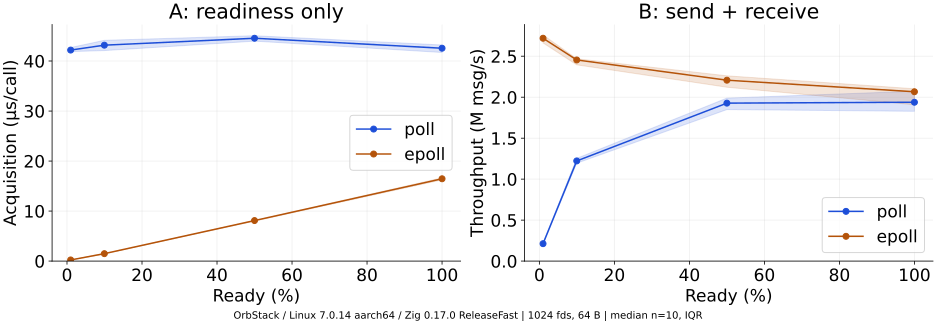
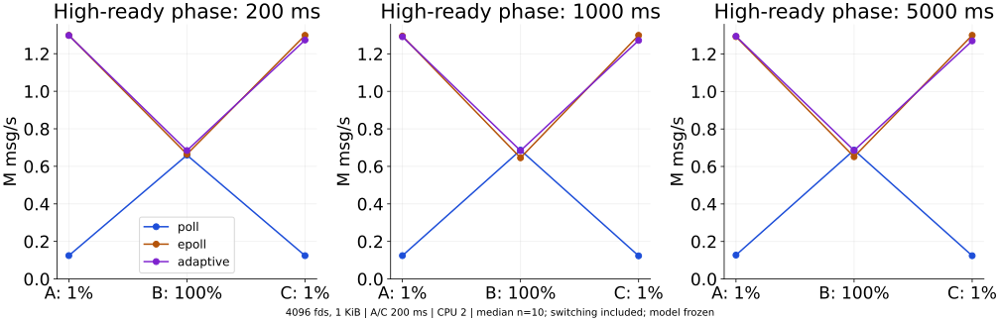
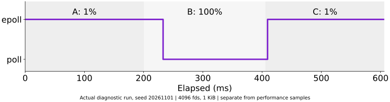

# poll / epoll 追加検証と原因分析

## 1. 検証の目的

低Ready率の大差と、全Readyの小さな逆転を同じ理由で説明しない。待機API・イベント走査・送信・受信・Adaptive切替を分けて確認する。逆転やAdaptive改善を成功条件にせず、全条件を掲載する。

開始時のlocal mainとorigin/mainはともに`09cbca517845312ddffb10eff853015c59081748`。開始時の作業ツリーはclean。過去の全raw・環境・分析・CSV・SVGはSHA-256 manifestで保護し、新しい結果は`results/audit-v2/`へ保存した。

## 2. 実験環境

OrbStack上のFedora Linux VM、aarch64、Linux `7.0.14-orbstack-00380-ga7e0a2dc9535`、論理CPU 8、Zig 0.17.0、ReleaseFast。追加測定はCPU 2固定を基本とし、別seedのaffinity未固定系列も分離した。VM内のCPU固定はホストの物理CPU専有を保証しない。

詳細は[environment.json](results/audit-v2/environment.json)。lscpu（モデル名は`-`、vendor Apple。物理CPUのモデルは未確認）、利用可能CPU、fd上限1,048,576、OS、Git SHA、ソースSHA、モデルSHA、測定開始/終了のloadavgと/proc/statを記録した。各runの実行順と開始/終了時刻をrawに保存。測定時のZigソースは`source-snapshot/`にSHA一致を確認して保存した。測定後にCLI引数ガードとControllerの正しさテストを加えたが、通常条件のアルゴリズム・モデルは変えていない。基本系列のCPU負荷は開始/終了のみで、runごとの詳細やホスト負荷・周波数は取得していない。後続の確認・warmup先行系列ではrunごとのloadavgも記録した。CPU時間はgetrusage差分のµs粒度で、壁時計と完全同一の境界ではない。解析の一部は同VMで実行され、完全に隔離された無負荷測定ではない。

## 3. poll / epollの仕組み

`poll`は毎回渡されたfd配列をカーネルで走査し、`do_pollfd()`から`vfs_poll()`を呼んで各fdの状態を確認する。ユーザー側もreventsから索引を作るため配列を走査する。

`epoll_ctl(ADD)`ではInterest Listに監視対象を保持し、対象ファイルのWait Queueへ通知用callbackを登録する。上流v7.0.14ではInterest Listの索引は`rbr`、Ready Listは`rdllist`。`ep_ptable_queue_proc()`が`ep_poll_callback()`を登録し、通知時に対象をReady Listへ連結する。`epoll_wait()`の`ep_send_events()`はReady Listの候補を処理する。Interest List全体を毎回走査する経路ではない。

ただしReady Listは「必ず読める一覧」ではない。`ep_item_poll()`で準備状態を再確認してからユーザー空間へイベントをコピーし、Level-triggeredでは候補を再配置する。全Readyなら対象数に応じた仕事が残る。「epollはO(1)」「Ready Listをコピーするだけ」とは説明できない。

**ソースの範囲**：測定カーネルのベースと同じ上流stable **v7.0.14**を参照した。OrbStack独自commit `a7e0a2dc9535`の公開ソースは取得できず、独自パッチと完全に同一であることは未確認。[kernel-provenance.json](results/audit-v2/kernel-provenance.json)にURL・SHA・行番号を記録。最新版mainの実装を測定版と同一視していない。

## 4. ベンチマーク設計と公平性の監査

### 共通部分

同一seedの同一fd集合、同一のReady集合、送信順・量・内容、non-blocking socketpair、同一の受信関数を使用する。イベント容量は両方Nで、epollのmaxeventsによるReady数の打ち切りはない。1fdあたりの受信予算は最大1 KiB。部分送受信、EINTR、EAGAIN、EOF、エラー、byte数・内容・全fd受信を検証する。

### 同一ではない部分

pollの返却索引はfd配列順、epollはカーネルのイベント順。この違いは元の実装に存在し、キャッシュや受信順の影響を含む。追加の`ascending`条件は**同じReady集合へのProducer送信順だけ**を昇順にする対照で、epollの返却順を強制するものではない。

初期登録・socket作成・配列確保はループ外。epoll初期化は`setup_ns`へ分離する。一方、送信による通知callback/Ready List維持はProducer中に発生し得るため、送信込みEnd-to-Endには入る。poll固定ではepollを登録しない。Adaptiveのpoll期間もepollをcloseする。

### 計測境界

- 実験A：Ready集合を固定しtimeout=0でLT再通知を繰り返す。`acquisition_ns`はAPI+索引変換。Ready集合照合はこの区間外だが`duration_ns`内。送受信は区間外。
- 実験B：Producer開始から全受信・照合完了までがEnd-to-End。Producer・Consumer・取得を別途保存。Consumerには受信・内容照合も含む。区間間のgetrusage/時計などの残余があるので、個別の中央値を引き算して厳密な加法分解とはしない。
- `events_observed`は取得イベントの累計。Aでは同じfdの再通知なのでメッセージ数ではない。Bの`messages`はペイロードを完全受信したfdバースト数。
- 新しいprobeはAPIのみ、走査のみ、集合検証のみ、時計のみを**別ループ**で計測。ループ分岐・checksum・戻り値確認なども含み、カーネル内部のCPU時間そのものではない。キャッシュ・処理状態が異なり、足し算で元の区間を復元する値ではない。

### 集計監査と修正

過去6系列を一時ディレクトリで再集計し、analysisの数値・summary.csvが一致した（[記録](results/audit-v2/reaggregation.json)）。seed/runのペアは既存rawでは正しかったが、コードに重複runやseed不一致を検出するガードがなかったため追加した。過去の結果は変更していない。

有効系列内で外れ値は除外せずwarmupのみ除外する。初回の追加動的系列にはwarmup順序の不備があり、主解析と分離して全結果を保存・別掲した。新集計は対応するseed/runの比の中央値、10,000回percentile bootstrapの95%区間、正確符号検定を保存。過去全条件・追加固定条件・追加動的条件をそれぞれfamilyとしHolm補正も記録する。探索後のn=10の小差を「頑健な普遍的逆転」と断定しない。bootstrapはVM時系列依存や条件探索の問題を解消しない。

別系列はseed・測定順の異なる**同一VMでの反復**であり、独立した物理環境ではない。初回fixedとend-to-endは同じseedを含むため、その2系列を独立した逆転の再現とは数えない。Adaptiveモデルは別系列crossover-checkのrun1..5のみから作成し、動的評価と分離されている。

## 5. 測定結果

<!-- AUDIT_RESULTS -->
主解析は **1,430 sample**（warmup 67を別保存）。このほか、warmup順序に不備のあった初回動的90 sample＋warmup 9も保存・別掲。診断は別run。過去2,981行の整合性も確認した。

### A：Readinessの区間別プローブ

単位µs/回、各20回の中央値。64 Bを事前投入。APIはsyscall単体、取得はAPI+索引変換、走査・集合検証は準備済み結果を別ループで処理する。

| fd / Ready | 方式 | API | 取得 | 走査 | 集合検証 | 取得 ns/event |
|---|---|---:|---:|---:|---:|---:|
| 1024 / 10 | poll | 42.587 | 42.372 | 0.435 | 0.032 | 4237.2 |
| 1024 / 10 | epoll | 0.220 | 0.225 | 0.008 | 0.032 | 22.5 |
| 1024 / 1024 | poll | 41.993 | 42.807 | 0.469 | 0.830 | 41.8 |
| 1024 / 1024 | epoll | 15.948 | 16.504 | 0.320 | 0.816 | 16.1 |
| 4096 / 41 | poll | 288.490 | 289.439 | 1.654 | 0.130 | 7059.5 |
| 4096 / 41 | epoll | 0.551 | 0.566 | 0.018 | 0.133 | 13.8 |
| 4096 / 4096 | poll | 293.732 | 294.207 | 1.822 | 3.263 | 71.8 |
| 4096 / 4096 | epoll | 124.594 | 127.051 | 1.227 | 3.226 | 31.0 |

時計ペアだけのループは約24ns/回。約225nsの最短epoll取得に対して無視できないため、数ns差を解釈したり機械的に引き算したりしない。APIの費用はユーザー走査より大きく、全Readyでもepoll取得が速い。

### B：送受信の対照（4,096 fd / 1 KiB / 64バースト）

CPU 2固定、各30回。時間はµs/バーストの中央値。各区間中央値は別々に計算するので和が総時間中央値に一致するとは限らない。

| Ready | 送信順 | 方式 | Producer | Consumer | 取得（Consumer内） | End-to-End | CPU user / system |
|---:|---|---|---:|---:|---:|---:|---:|
| 41 | shuffled | poll | 8.97 | 333.66 | 305.54 | 342.79 | 16.0 / 336.7 |
| 41 | shuffled | epoll | 8.82 | 22.87 | 0.78 | 31.90 | 15.6 / 16.6 |
| 41 | shuffled | poll-watched | 11.74 | 328.68 | 299.74 | 340.81 | 16.4 / 324.6 |
| 41 | ascending | poll | 9.02 | 335.00 | 306.52 | 344.08 | 16.4 / 327.5 |
| 41 | ascending | epoll | 8.79 | 22.82 | 0.78 | 31.82 | 14.7 / 20.6 |
| 41 | ascending | poll-watched | 11.70 | 329.25 | 300.64 | 341.54 | 15.8 / 332.6 |
| 4096 | shuffled | poll | 2169.01 | 3774.11 | 574.63 | 5940.64 | 2188.8 / 3807.5 |
| 4096 | shuffled | epoll | 2526.23 | 3690.85 | 238.44 | 6217.62 | 2218.1 / 4062.4 |
| 4096 | shuffled | poll-watched | 2709.07 | 4061.51 | 659.10 | 6779.22 | 2281.8 / 4470.9 |
| 4096 | ascending | poll | 1911.80 | 3647.86 | 600.48 | 5564.86 | 2127.1 / 3502.5 |
| 4096 | ascending | epoll | 2166.14 | 3357.87 | 205.38 | 5526.02 | 2135.6 / 3425.7 |
| 4096 | ascending | poll-watched | 2184.63 | 3689.31 | 629.34 | 5874.72 | 2202.6 / 3773.4 |

| Ready / 送信順 / CPU | poll/epoll費用比中央値 | 95%区間 | pollが速いペア | Holm補正符号検定p |
|---|---:|---|---:|---:|
| 41 / shuffled / CPU 2 | 10.7744 | 10.6617–10.8027 | 0/30 | 1.3039e-08 |
| 41 / ascending / CPU 2 | 10.7449 | 10.5985–10.8579 | 0/30 | 1.3039e-08 |
| 4096 / shuffled / CPU 2 | 0.9567 | 0.9373–0.9721 | 23/30 | 0.026114 |
| 4096 / ascending / CPU 2 | 1.0039 | 0.9944–1.0181 | 13/30 | 1 |
| 4096 / shuffled / 未固定・別seed | 0.9828 | 0.9416–1.0288 | 16/30 | 1 |
| 4096 / shuffled / CPU 2・第2seed | 0.9733 | 0.9653–0.9969 | 20/30 | 0.39495 |
| 4096 / ascending / CPU 2・第2seed | 0.9979 | 0.9849–1.0091 | 16/30 | 1 |

CPU固定・ランダム送信ではpollの費用がペア中央値で約4.33%小さい。一方、昇順送信は明確な差がなく、affinity未固定の別seed追試も区間が1をまたいだ。解析・描画終了後の別seed再測定ではランダム順の中央値は同方向（約2.67%短縮、pointwise bootstrap区間は1未満）だったが、Holm補正符号検定p=0.395で、優位性が強く再現したとは断定しない。昇順は区間が1をまたいだ（表の第2seed行）。負の結果も含め、普遍的なpoll優位とはしない。`poll-watched`ではProducer時間が増え、監視登録の存在が送信側にも影響し得ることを確認した。

### C：Adaptiveの区間別結果

過去200ms系列のPhase別中央値（各10回）。CPUはuser+systemのµs。過去rawにはPhase別切替情報がないため、切替時刻を後から捏造していない。

| 方式 | Phase | M msg/s | CPU µs | 完了バースト |
|---|---|---:|---:|---:|
| poll | A | 0.1250 | 200180.0 | 610.0 |
| poll | B | 0.6857 | 204031.5 | 34.0 |
| poll | C | 0.1246 | 200190.5 | 608.5 |
| epoll | A | 1.2949 | 200017.0 | 6317.0 |
| epoll | B | 0.6611 | 203625.0 | 33.0 |
| epoll | C | 1.3023 | 200018.0 | 6353.5 |
| adaptive | A | 1.2939 | 200011.0 | 6312.0 |
| adaptive | B | 0.6899 | 201225.5 | 34.0 |
| adaptive | C | 1.2764 | 200023.0 | 6227.0 |

追加の固定モデル評価。A/C各200ms、Bのみ変更、CPU 2固定。各方式10回、通常測定は診断無効。

| Bの長さ | Adaptive/epoll改善率 | 95%区間 | 切替回数中央値 | 合計切替ms | Holm補正p |
|---|---:|---|---:|---:|---:|
| 200 ms | -0.19% | -2.25–+2.25% | 2 | 2.183 | 0.75391 |
| 1000 ms | +2.53% | +1.75–+3.57% | 2 | 2.233 | 0.042969 |
| 5000 ms | +4.51% | +3.58–+4.95% | 2 | 2.223 | 0.0058594 |

200ms：改善未確認 / 1000ms：改善確認 / 5000ms：改善確認。全3条件を事前指定し、評価後のモデル調整はない。このVMと条件での結果であり、本番への保証ではない。

| Bの長さ | Phase | 方式 | M msg/s | CPU µs | バースト | 切替回数 / ms |
|---|---|---|---:|---:|---:|---:|
| 200 ms | A | poll | 0.1244 | 200149.5 | 607.5 | 0 / 0.000 |
| 200 ms | B | poll | 0.6597 | 203183.0 | 32.5 | 0 / 0.000 |
| 200 ms | C | poll | 0.1240 | 200143.5 | 605.5 | 0 / 0.000 |
| 200 ms | A | epoll | 1.2982 | 200019.0 | 6333.5 | 0 / 0.000 |
| 200 ms | B | epoll | 0.6647 | 202355.5 | 33.0 | 0 / 0.000 |
| 200 ms | C | epoll | 1.2981 | 200022.5 | 6332.5 | 0 / 0.000 |
| 200 ms | A | adaptive | 1.2974 | 200008.0 | 6329.0 | 0 / 0.000 |
| 200 ms | B | adaptive | 0.6842 | 204680.5 | 34.0 | 1 / 0.463 |
| 200 ms | C | adaptive | 1.2730 | 200021.5 | 6210.5 | 1 / 1.690 |
| 1000 ms | A | poll | 0.1242 | 200239.5 | 607.0 | 0 / 0.000 |
| 1000 ms | B | poll | 0.6867 | 1003255.5 | 168.0 | 0 / 0.000 |
| 1000 ms | C | poll | 0.1230 | 200071.5 | 600.5 | 0 / 0.000 |
| 1000 ms | A | epoll | 1.2948 | 200020.0 | 6316.5 | 0 / 0.000 |
| 1000 ms | B | epoll | 0.6457 | 1003086.5 | 158.0 | 0 / 0.000 |
| 1000 ms | C | epoll | 1.2989 | 200023.0 | 6336.5 | 0 / 0.000 |
| 1000 ms | A | adaptive | 1.2913 | 200017.5 | 6299.5 | 0 / 0.000 |
| 1000 ms | B | adaptive | 0.6837 | 1001889.0 | 167.5 | 1 / 0.509 |
| 1000 ms | C | adaptive | 1.2717 | 200023.5 | 6204.0 | 1 / 1.724 |
| 5000 ms | A | poll | 0.1272 | 200175.5 | 621.0 | 0 / 0.000 |
| 5000 ms | B | poll | 0.6874 | 5002016.5 | 839.5 | 0 / 0.000 |
| 5000 ms | C | poll | 0.1238 | 200123.0 | 604.5 | 0 / 0.000 |
| 5000 ms | A | epoll | 1.2925 | 200015.0 | 6305.5 | 0 / 0.000 |
| 5000 ms | B | epoll | 0.6518 | 5003111.0 | 796.0 | 0 / 0.000 |
| 5000 ms | C | epoll | 1.2997 | 200017.0 | 6340.5 | 0 / 0.000 |
| 5000 ms | A | adaptive | 1.2946 | 200022.0 | 6315.5 | 0 / 0.000 |
| 5000 ms | B | adaptive | 0.6853 | 5001545.0 | 837.0 | 1 / 0.471 |
| 5000 ms | C | adaptive | 1.2698 | 200015.5 | 6194.5 | 1 / 1.739 |

Phase別中央値は足し合わせられないため、同じrun/seedペアごとに全体速度差を分解した。全体速度R=Σ(Phase時間比w × Phase速度r)より、差はΣ[w_epoll×(r_adaptive−r_epoll) + (w_adaptive−w_epoll)×r_adaptive]。下表は各寄与をepoll全体速度で割った**ペア平均のpercentage point**。和は平均改善率に厳密に一致するが、上のペア中央値とは異なる。

| 系列 / B長 | Aの速度差寄与 | Bの速度差寄与 | Cの速度差寄与 | 時間比の変化 | 平均改善率 |
|---|---:|---:|---:|---:|---:|
| historical / 200 ms | +0.432 pp | +0.527 pp | -0.886 pp | +0.074 pp | +0.147% |
| audit / 200 ms | -0.031 pp | +0.730 pp | -0.718 pp | -0.078 pp | -0.097% |
| audit / 1000 ms | -0.106 pp | +2.849 pp | -0.436 pp | +0.017 pp | +2.324% |
| audit / 5000 ms | +0.017 pp | +4.486 pp | -0.182 pp | +0.002 pp | +4.323% |

Aには切替がないので、その差を切替費用とは解釈できず、VM変動等も含む。Bの利益とCの復帰区間の損失は表を対比する。分解は差の発生区間を示す恒等式であり、kernel関数やcacheに対する因果分解ではない。全ペアを`phase-contributions.csv`に保存した。

### D：Oracleの規模と回収時間（記述的推定）

| Bの長さ | 後知恵の理想改善 | 既存選択固定の改善 | 固定選択の高Ready追加メッセージ | 切替時間だけの回収に必要なBの長さ |
|---|---:|---:|---:|---:|
| 200 ms | 0.00% | -0.15% | -1005 | 定義なし（poll優位なし） |
| 1000 ms | 3.52% | 3.52% | 41018 | 35.2 ms |
| 5000 ms | 4.72% | 4.72% | 178372 | 40.6 ms |

200msの固定方式系列ではBもepollを選ぶのが速く、後知恵の理想選択はepoll固定（費用なし改善0%）。表の200ms負値は既存の選択epoll→poll→epollを固定した評価で、両者を混同しない。1秒・5秒の理想選択はepoll→poll→epoll。固定方式の別runのPhase速度中央値からの近似で、同一runの数学的上限ではない。ノイズや中央値の非加法性により実測改善がこの推定を超える場合もある。回収時間は切替だけを考えた楽観値であり、Bへ追随する約26–33ms、Cでの復帰遅延・低下、CPU状態差を含まない。短い200msでは固定方式の小差自体が系列で変わり、利益が得られる前提も安定しない。

### warmup順序の修正前後

初回runnerはrun=0を本測定と混ぜてシャッフルしていた。これはwarmup先行の要件を満たさないため、全9 warmupを先に完了する別系列を追加した。同じworkload seedと固定モデル、別実行順で、速度の結果を理由に除外したものではない。初回rawは`dynamic.jsonl`、その時点の分析は`initial-dynamic-analysis/`へ保持。最終の主解析は`dynamic-warmed.jsonl`。測定時刻と実行順も変わるため、修正前後の差をwarmupそのものの因果効果とは解釈しない。

| Bの長さ | 初回改善率・95%区間 | warmup先行の改善率・95%区間 |
|---|---|---|
| 200 ms | -0.91% [-2.30, +2.01] | -0.19% [-2.25, +2.25] |
| 1000 ms | +1.65% [+1.23, +1.85] | +2.53% [+1.75, +3.57] |
| 5000 ms | +4.40% [+3.69, +6.78] | +4.51% [+3.58, +4.95] |

<!-- /AUDIT_RESULTS -->

## 6. 低Ready率でepollが有利な理由

少数のReady対象を得るのにpollは全監視fdを確認する。上流カーネル実装とprobeの両方で、この違いと整合する。ユーザー空間の走査だけでは差を説明できず、API内の時間が大半を占める。epollは監視時に登録・通知の仕事を行い、待機時にReady候補へ対象を絞れる。ただし登録費用を含む短命接続の総費用を本実験は評価していない。

## 7. 高Ready率で差が縮まる理由

epollもReady数が増えれば状態再確認・イベントコピー・LT再配置が増える。pollは監視fd数が同じなら全配列走査が残る。さらにBでは送受信・内容照合の共通費用が増え、取得APIの差が全体へ占める割合が小さくなる。全ReadyでもAの取得ではepoll優位であり、「高Readyならpollの待機APIが勝つ」とは言えない。

## 8. poll優位が観測された条件と限界

過去の4096fd・全Ready・1KiB・送信込み系列で小さなpoll優位があった。end-to-end-replicationのpoll/epoll費用比中央値0.9806、点ごとの95%区間0.9624〜0.9920。これは条件探索後のn=10の結果である。

今回、Producerの送信順を変えた対照と、pollで待つままepoll登録を残す`poll-watched`を追加。後者は送信時の通知経路を残すが、epoll_waitを呼ばずReady Listに残る状態も異なるため、callback一回だけの純粋な費用ではない。Producer時間が変化したことは確認できるが、全差を特定関数へ帰属させない。

配列の連続性、受信順、Ready Listの操作、socketデータのキャッシュ局所性は候補となる。送信順の対照は局所性への依存と整合するが、ハードウェアカウンタや因果分離が不十分で**キャッシュが原因と特定したわけではない**。

## 9. 200msでAdaptiveの改善を確認できなかった理由とOracle

過去の各200ms系列ではAdaptive/epollの完了速度比改善率中央値-0.40%、95%区間-1.61〜+2.48%。中央値2回、計2.13msの切替。Phase A/Cは低Readyでepollが大幅に速く、Phase Bのpoll優位は小さい。EMAが追随するまでの遅れ、最低継続バースト、epoll再登録の切替費用に対し、200msの高Ready区間で得られる利益が小さい。

旧Oracleの約0.80%は、固定方式の前半runからPhaseごとの方式を選び後半runで評価した値。等時間3Phaseの速度中央値を足した近似で、測定Phase時間のバースト超過や切替費用を含まない。これを実運用の改善予測やスイッチ費用の上限と解釈しない。

新分析はBの継続時間で重み付けし、Phase別の完了速度から理想的な切替の追加メッセージ数を見積もる。費用回収時間は`切替秒数 × epoll高Ready速度 / (poll高Ready速度 − epoll高Ready速度)`の近似。分母が正のときだけ定義し、追随遅延・過渡応答を無視するので保証値ではない。実測Adaptiveの結果と分ける。

Controllerは完了fd数のEMA、既存モデルの線形補間、16バースト継続、32バースト分の利益と切替見積×1.1の比較。推定切替費用は初期setup、その後は直近の切替時間を使う。closeと再登録の方向別費用を区別しないこと、固定32バーストhorizonは限界。今回モデル・係数は再調整していない。

## 10. 追加検証・切替ログ・再現性

Readiness4条件は各20回、固定の対照は各30回、別seed/affinity未固定は各30回。解析・描画を停止した別seedのCPU固定追試も、全Ready・送信順2条件で各30回追加した。高Ready区間200ms/1s/5sは各方式10回、A/Cは200ms固定。全てwarmupを別途記録し、測定順を事前seedでシャッフル。全rawを保存し、期待と異なる条件も掲載した。

診断は専用seed 20261101の別run。64バーストごとと全切替を事前確保メモリへ記録し、終了後出力する。通常性能測定では無効。ログの時刻は切替完了/記録時点であり、Phase開始や理想的な切替時点ではない。可視化も実測ログから生成する。診断の性能値を通常測定へ混ぜない。

<!-- DIAGNOSTIC_RESULTS -->
| Bの長さ | Phase / バースト | 実験開始からの完了時刻ms | 実切替 | EMA fd | 推定poll / epoll ms | 切替見積 / 実測ms |
|---|---|---:|---|---:|---:|---:|
| 200 ms | B / 5 | 232.883 | epoll→poll | 3133.7 | 4.849 / 4.971 | 2.295 / 0.463 |
| 200 ms | C / 3 | 409.258 | poll→epoll | 1751.4 | 2.828 / 2.763 | 0.463 / 1.702 |
| 1000 ms | B / 4 | 227.270 | epoll→poll | 2813.0 | 4.380 / 4.459 | 2.254 / 0.455 |
| 1000 ms | C / 3 | 1203.161 | poll→epoll | 1751.7 | 2.829 / 2.764 | 0.455 / 1.656 |
| 5000 ms | B / 4 | 226.291 | epoll→poll | 2813.0 | 4.380 / 4.459 | 2.083 / 0.452 |
| 5000 ms | C / 3 | 5204.035 | poll→epoll | 1751.7 | 2.829 / 2.764 | 0.452 / 1.711 |

B開始後4〜5バーストでpollへ、C開始後3バーストでepollへ復帰した。closeは約0.45ms、再登録は約1.7msで非対称だった。Phase別集計でもBで利益、Cで復帰に伴う損失が見える。診断による追加記録の費用を通常性能の結果には混ぜていないが、診断の時刻にはその記録費用が含まれる。

perfはcycles/instructionsが`<not supported>`。user限定のtask-clockとソフトウェア指標は出力されたが、単発のcontext-switches=0等から因果を断定しない。キャッシュの説明を実測済みにできるhardware counterは取得できなかった。strace別runでは双方sendto/recvfrom各262,144回、待機各64回、epollは初期登録4,096回を確認。tracer下の時間は性能集計から除外した。[観察ログ](results/audit-v2/observations.json)。

<!-- /DIAGNOSTIC_RESULTS -->

## 11. Webサーバへの一般化の限界

単一Consumerスレッドが先に全送信し、その後受信するUnix socketpairのバースト合成負荷。TCP、実ネットワーク、TLS、同時到着、複数スレッド、接続追加/削除、処理ロジック、実ストレージを再現しない。Aは同じfdのReady状態を再通知させるだけで、実際の通信イベントを繰り返し処理したものではない。

ソケットの固定集合に対する結果で、接続が激しく出入りする場合の登録・解除費用は別途必要。Adaptiveは完全drainした境界でのみ切替可能な設計。任意の並行到着やスレッド競合の正しさを保証しない。CPU affinity、VM、実行順、ペイロード、Producer順序が違う測定値を混ぜない。物理Linuxでの追試は未実施。

## 12. 参考資料と再現手順

[実行・JSONL・グラフ再生成手順](README.md#追加監査原因分析audit-v2)。元データから追加図と全統計を`python3 benchmarks/poll-epoll/audit-analyze.py`で再生成できる。過去分析の再計算は`audit-reaggregate.py`、整合性は`validate.py --output /tmp/validation.json`。

- [poll(2)](https://man7.org/linux/man-pages/man2/poll.2.html)
- [epoll(7)](https://man7.org/linux/man-pages/man7/epoll.7.html)
- [epoll_wait(2)](https://man7.org/linux/man-pages/man2/epoll_wait.2.html)
- [Linux stable v7.0.14 eventpoll.c](https://github.com/gregkh/linux/blob/v7.0.14/fs/eventpoll.c#L1267)
- [Linux stable v7.0.14 select.c](https://github.com/gregkh/linux/blob/v7.0.14/fs/select.c#L872)
- [Linux stable v7.0.14 Unix sockets](https://github.com/gregkh/linux/blob/v7.0.14/net/unix/af_unix.c#L2293)
- [Zig 0.17.0](https://ziglang.org/download/0.17.0/release-notes.html)、同梱`lib/std/os/linux.zig`とpoll/epollラッパー。

未解決：OrbStack固有カーネルパッチとの完全照合、ハードウェアカウンタによるキャッシュ要因の検証、独立した物理環境、より現実的な並行到着、方向別切替費用モデル。今回の結果で特定のWebサーバの採用方式を決めることはできない。
