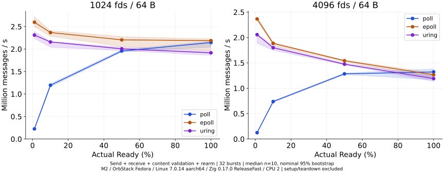
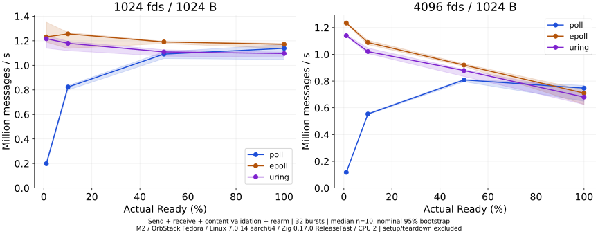
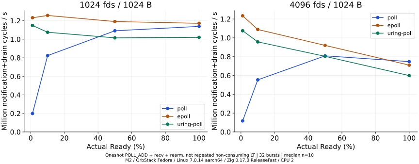
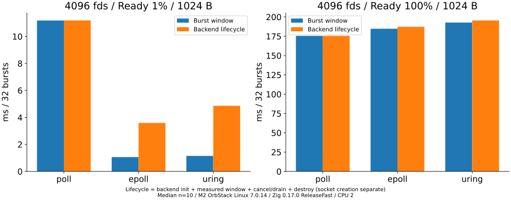
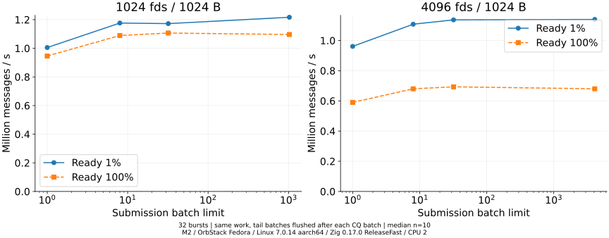

# io_uring RECV / POLL_ADDの実測（Zig 0.17.0）

## 1. 動作確認

M2 MacBook Air / OrbStack Fedora / Linux 7.0.14-orbstack-00380-ga7e0a2dc9535 / aarch64で、setup、SQ/CQ mmap、enter、REGISTER_PROBEが成功した。io_uring_disabled=0、Seccomp=0、NoNewPrivs=0。RECV/POLL_ADD/ASYNC_CANCELをprobeし、RECVの既知17byteの内容を検証した。libc/liburingリンクなし。使用にセキュリティ設定変更は行っていない。

REGISTER_PROBEは機能調査用で、基本RECV/POLL_ADDにfile/bufferの事前登録は不要。baselineはregistered files/buffersを使用しない。機能ビット262143、probe結果、errno、mmap成功のtraceはresults/main/phase0.jsonとobservations.jsonに保存。初期化失敗はerrnoを出力し、EPERMをkernel未対応と即断しない。

## 2. 比較設計と既存との関係

[BENCHMARK_DESIGN.md](BENCHMARK_DESIGN.md)を測定前に固定した。既存workload.zig/poll.zig/epoll.zig/metrics.zigを直接利用し、同一系列で再測定。NONBLOCK socketpair、単一スレッドでProducer全送信後にConsumerが受信する。過去のrawと直接つなげない。

Consumerは共通プロトコルのメッセージ数・サイズを知るが、未来のReady fdのidentityは受け取らない。全N fdへ未到着RECVを用意し、完了したfdのみ再投入する。inactiveな要求はバースト間で保持する。Producerの順列を各バースト1個回転し、別集合・同一socketの再受信を行う。

N64/256/1024/4096、要求Ready率1/10/50/100%、payload64/1024B。Ready数はceil(N*pct/100)。1条件32バースト×10 sample、全warmupを先行し、run/seedを対応付け、方式・条件順を事前seedでシャッフルした。ReleaseFast、CPU2。guest affinityは物理CPU専有を保証しない。

## 3. Ready通知と操作完了

poll/epollは通知後にrecvする。POLL_ADDもoneshot通知→recv→再武装を行う。一方RECVはCQEの正のres分が専用bufferへ到着したことを検証する。部分受信は残りを再投入し、EAGAIN/EINTRを再試行する。EOF・未知の負の結果を正常なデータとして扱わない。

POLL_ADDの結果は「通知→排出→再武装」のサイクル。既存Aのデータ非消費LT再通知とは契約が違うため専用グラフへ分離した。

## 4. End-to-End主比較

Producer開始→全受信・内容検証→次回の再投入/flushまで。最後のバーストでは完了fdを再投入しないため、32バーストの再投入境界は31回。初期要求と最後のinactive要求の終了は別計時する。無限steady-stateではなく有限のバースト区間である。

baseline RECV対epollのペア速度比中央値は今回の全32条件で1を超えなかった。小差や多条件探索を確認的な有意差と呼ばず、実サーバ・Linux全般へ一般化しない。

<!-- BASELINE -->
| N | Ready個数 | B/msg | 方式 | msg/s | 名目95%区間 | backend初期化/終了込みmsg/s |
| --- | --- | --- | --- | --- | --- | --- |
| 64 | 1 | 64 | poll | 375,590 | 351,618–398,511 | 374,851 |
| 64 | 1 | 64 | epoll | 1,682,636 | 1,532,714–1,749,303 | 647,285 |
| 64 | 1 | 64 | uring | 1,386,336 | 1,158,665–1,422,297 | 438,284 |
| 64 | 1 | 1024 | poll | 330,542 | 315,666–346,059 | 329,974 |
| 64 | 1 | 1024 | epoll | 1,011,641 | 938,692–1,047,669 | 514,698 |
| 64 | 1 | 1024 | uring | 887,361 | 818,707–908,575 | 344,111 |
| 64 | 7 | 64 | poll | 1,348,583 | 1,325,099–1,519,468 | 1,347,398 |
| 64 | 7 | 64 | epoll | 2,461,715 | 2,366,154–2,593,215 | 1,870,622 |
| 64 | 7 | 64 | uring | 2,141,129 | 2,066,112–2,256,904 | 1,478,370 |
| 64 | 7 | 1024 | poll | 970,857 | 956,777–988,568 | 970,245 |
| 64 | 7 | 1024 | epoll | 1,338,564 | 1,237,284–1,355,867 | 1,140,180 |
| 64 | 7 | 1024 | uring | 1,240,857 | 1,207,287–1,273,922 | 955,097 |
| 64 | 32 | 64 | poll | 2,286,457 | 2,111,499–2,415,305 | 2,285,283 |
| 64 | 32 | 64 | epoll | 2,618,123 | 2,432,333–2,758,768 | 2,389,253 |
| 64 | 32 | 64 | uring | 2,419,041 | 2,164,520–2,493,996 | 2,210,779 |
| 64 | 32 | 1024 | poll | 1,231,298 | 1,049,406–1,250,429 | 1,231,050 |
| 64 | 32 | 1024 | epoll | 1,316,100 | 1,147,823–1,346,559 | 1,273,702 |
| 64 | 32 | 1024 | uring | 1,223,816 | 1,085,372–1,257,382 | 1,156,221 |
| 64 | 64 | 64 | poll | 2,463,007 | 2,278,941–2,500,229 | 2,462,575 |
| 64 | 64 | 64 | epoll | 2,503,132 | 2,386,485–2,582,715 | 2,419,746 |
| 64 | 64 | 64 | uring | 2,286,305 | 2,118,995–2,332,665 | 2,193,354 |
| 64 | 64 | 1024 | poll | 1,256,578 | 1,165,850–1,283,017 | 1,256,481 |
| 64 | 64 | 1024 | epoll | 1,289,469 | 1,200,311–1,300,095 | 1,266,613 |
| 64 | 64 | 1024 | uring | 1,151,732 | 1,095,359–1,199,995 | 1,126,602 |
| 256 | 3 | 64 | poll | 250,856 | 233,270–261,061 | 250,706 |
| 256 | 3 | 64 | epoll | 2,281,556 | 2,125,446–2,320,300 | 593,661 |
| 256 | 3 | 64 | uring | 1,893,880 | 1,828,606–1,936,108 | 325,634 |
| 256 | 3 | 1024 | poll | 233,719 | 213,531–236,134 | 233,554 |
| 256 | 3 | 1024 | epoll | 1,202,916 | 1,161,862–1,248,780 | 485,557 |
| 256 | 3 | 1024 | uring | 1,097,738 | 1,062,364–1,165,968 | 295,331 |
| 256 | 26 | 64 | poll | 1,276,858 | 1,238,012–1,296,151 | 1,276,491 |
| 256 | 26 | 64 | epoll | 2,765,151 | 2,698,404–2,791,937 | 2,003,681 |
| 256 | 26 | 64 | uring | 2,428,173 | 2,419,054–2,464,693 | 1,484,281 |
| 256 | 26 | 1024 | poll | 833,388 | 763,246–845,152 | 833,039 |
| 256 | 26 | 1024 | epoll | 1,305,832 | 1,157,511–1,354,590 | 1,104,518 |
| 256 | 26 | 1024 | uring | 1,254,494 | 1,145,105–1,276,152 | 898,730 |
| 256 | 128 | 64 | poll | 2,050,401 | 1,742,979–2,135,186 | 2,050,187 |
| 256 | 128 | 64 | epoll | 2,412,416 | 2,159,571–2,438,905 | 2,251,219 |
| 256 | 128 | 64 | uring | 2,120,947 | 1,911,822–2,232,404 | 2,002,769 |
| 256 | 128 | 1024 | poll | 1,173,095 | 1,142,843–1,187,033 | 1,172,920 |
| 256 | 128 | 1024 | epoll | 1,261,352 | 1,240,767–1,294,427 | 1,219,228 |
| 256 | 128 | 1024 | uring | 1,191,373 | 1,151,439–1,208,671 | 1,142,470 |
| 256 | 256 | 64 | poll | 2,270,275 | 2,215,175–2,423,967 | 2,270,051 |
| 256 | 256 | 64 | epoll | 2,315,025 | 2,135,697–2,481,827 | 2,230,154 |
| 256 | 256 | 64 | uring | 2,023,936 | 1,919,332–2,209,746 | 1,969,362 |
| 256 | 256 | 1024 | poll | 1,235,957 | 1,186,861–1,254,749 | 1,235,894 |
| 256 | 256 | 1024 | epoll | 1,237,405 | 1,203,400–1,269,460 | 1,213,675 |
| 256 | 256 | 1024 | uring | 1,198,058 | 1,151,994–1,214,236 | 1,175,182 |
| 1024 | 11 | 64 | poll | 225,354 | 218,050–233,616 | 225,114 |
| 1024 | 11 | 64 | epoll | 2,596,539 | 2,492,234–2,718,147 | 577,207 |
| 1024 | 11 | 64 | uring | 2,310,595 | 2,236,189–2,389,778 | 391,646 |
| 1024 | 11 | 1024 | poll | 198,545 | 185,750–214,058 | 198,353 |
| 1024 | 11 | 1024 | epoll | 1,231,852 | 1,188,564–1,351,242 | 430,921 |
| 1024 | 11 | 1024 | uring | 1,216,855 | 1,139,620–1,243,046 | 332,279 |
| 1024 | 103 | 64 | poll | 1,196,523 | 1,157,016–1,223,497 | 1,195,691 |
| 1024 | 103 | 64 | epoll | 2,366,834 | 2,283,062–2,409,799 | 1,754,471 |
| 1024 | 103 | 64 | uring | 2,157,662 | 2,042,297–2,168,207 | 1,451,313 |
| 1024 | 103 | 1024 | poll | 823,262 | 798,304–834,789 | 822,932 |
| 1024 | 103 | 1024 | epoll | 1,256,499 | 1,138,012–1,267,142 | 1,060,051 |
| 1024 | 103 | 1024 | uring | 1,179,455 | 1,119,471–1,195,754 | 899,568 |
| 1024 | 512 | 64 | poll | 1,955,892 | 1,936,560–1,986,028 | 1,955,533 |
| 1024 | 512 | 64 | epoll | 2,204,204 | 2,054,975–2,277,137 | 2,058,951 |
| 1024 | 512 | 64 | uring | 2,005,303 | 1,965,105–2,043,262 | 1,852,570 |
| 1024 | 512 | 1024 | poll | 1,091,271 | 1,055,700–1,111,014 | 1,091,144 |
| 1024 | 512 | 1024 | epoll | 1,190,656 | 1,177,356–1,195,383 | 1,148,053 |
| 1024 | 512 | 1024 | uring | 1,109,227 | 1,074,339–1,126,109 | 1,062,303 |
| 1024 | 1024 | 64 | poll | 2,145,096 | 2,043,420–2,174,190 | 2,144,850 |
| 1024 | 1024 | 64 | epoll | 2,186,796 | 1,970,873–2,225,707 | 2,114,395 |
| 1024 | 1024 | 64 | uring | 1,916,601 | 1,861,140–1,961,034 | 1,849,943 |
| 1024 | 1024 | 1024 | poll | 1,138,654 | 1,047,034–1,170,187 | 1,138,587 |
| 1024 | 1024 | 1024 | epoll | 1,171,484 | 1,136,027–1,178,564 | 1,150,417 |
| 1024 | 1024 | 1024 | uring | 1,096,257 | 1,066,222–1,106,923 | 1,075,053 |
| 4096 | 41 | 64 | poll | 125,173 | 121,154–125,944 | 125,105 |
| 4096 | 41 | 64 | epoll | 2,365,585 | 2,339,118–2,405,877 | 431,982 |
| 4096 | 41 | 64 | uring | 2,056,690 | 1,885,604–2,066,294 | 318,052 |
| 4096 | 41 | 1024 | poll | 117,332 | 116,067–118,970 | 117,263 |
| 4096 | 41 | 1024 | epoll | 1,233,906 | 1,229,864–1,237,373 | 365,004 |
| 4096 | 41 | 1024 | uring | 1,139,406 | 1,136,033–1,145,184 | 269,843 |
| 4096 | 410 | 64 | poll | 738,740 | 722,410–749,444 | 738,481 |
| 4096 | 410 | 64 | epoll | 1,884,982 | 1,849,788–1,902,011 | 1,373,699 |
| 4096 | 410 | 64 | uring | 1,799,204 | 1,746,754–1,839,372 | 1,249,214 |
| 4096 | 410 | 1024 | poll | 553,639 | 549,222–558,726 | 553,490 |
| 4096 | 410 | 1024 | epoll | 1,088,315 | 1,072,224–1,104,900 | 899,290 |
| 4096 | 410 | 1024 | uring | 1,020,550 | 1,005,501–1,046,857 | 794,559 |
| 4096 | 2048 | 64 | poll | 1,284,317 | 1,271,199–1,300,098 | 1,284,132 |
| 4096 | 2048 | 64 | epoll | 1,542,519 | 1,520,448–1,556,306 | 1,451,371 |
| 4096 | 2048 | 64 | uring | 1,474,165 | 1,461,048–1,494,304 | 1,386,734 |
| 4096 | 2048 | 1024 | poll | 808,450 | 795,042–814,124 | 808,386 |
| 4096 | 2048 | 1024 | epoll | 919,478 | 909,846–928,969 | 887,853 |
| 4096 | 2048 | 1024 | uring | 878,672 | 834,018–886,407 | 842,497 |
| 4096 | 4096 | 64 | poll | 1,322,557 | 1,166,930–1,382,870 | 1,322,429 |
| 4096 | 4096 | 64 | epoll | 1,265,678 | 1,208,587–1,302,581 | 1,234,773 |
| 4096 | 4096 | 64 | uring | 1,190,392 | 1,137,691–1,243,456 | 1,165,927 |
| 4096 | 4096 | 1024 | poll | 747,179 | 649,404–766,969 | 747,144 |
| 4096 | 4096 | 1024 | epoll | 709,688 | 625,049–734,896 | 699,949 |
| 4096 | 4096 | 1024 | uring | 680,059 | 624,534–716,374 | 670,421 |

<!-- /BASELINE -->

全Ready/4096fd/1024Bでは約0.747/0.710/0.680 Mmsg/s（poll/epoll/RECV）。この系列でも高Ready時にpoll優位の点があったが、集合回転やinstrumentationが違い、過去の結果を置換しない。

RECVはrecv syscallを減らす一方、要求準備・共有キュー・完了検証・再投入の費用がある。同じスレッドのsend中にもkernelの受信処理が進み得るためProducer時間にも費用が現れる。kernel内cycles/cache missを測った実験ではなく、遅さを特定の内部要因へ帰属しない。

### POLL_ADDは専用比較

<!-- NOTIFY -->
| N | Ready個数 | B/msg | 方式 | msg/s | 名目95%区間 | backend初期化/終了込みmsg/s |
| --- | --- | --- | --- | --- | --- | --- |
| 64 | 1 | 64 | uring-poll | 1,289,644 | 1,192,428–1,356,335 | 544,872 |
| 64 | 1 | 1024 | uring-poll | 821,977 | 781,269–839,278 | 368,613 |
| 64 | 7 | 64 | uring-poll | 1,918,866 | 1,804,662–2,046,466 | 1,450,854 |
| 64 | 7 | 1024 | uring-poll | 1,193,996 | 1,144,802–1,205,136 | 977,191 |
| 64 | 32 | 64 | uring-poll | 1,985,699 | 1,910,484–2,070,554 | 1,842,832 |
| 64 | 32 | 1024 | uring-poll | 1,142,313 | 997,486–1,170,226 | 1,104,918 |
| 64 | 64 | 64 | uring-poll | 1,945,672 | 1,781,347–2,016,748 | 1,905,600 |
| 64 | 64 | 1024 | uring-poll | 1,101,117 | 1,026,457–1,145,629 | 1,085,307 |
| 256 | 3 | 64 | uring-poll | 1,696,057 | 1,529,706–1,763,695 | 426,769 |
| 256 | 3 | 1024 | uring-poll | 1,045,424 | 969,286–1,105,558 | 364,166 |
| 256 | 26 | 64 | uring-poll | 2,037,504 | 1,995,724–2,149,415 | 1,491,769 |
| 256 | 26 | 1024 | uring-poll | 1,137,173 | 997,899–1,164,604 | 902,755 |
| 256 | 128 | 64 | uring-poll | 1,867,092 | 1,681,932–1,946,072 | 1,810,064 |
| 256 | 128 | 1024 | uring-poll | 1,071,075 | 1,031,449–1,103,223 | 1,044,629 |
| 256 | 256 | 64 | uring-poll | 1,782,777 | 1,661,591–1,924,887 | 1,757,949 |
| 256 | 256 | 1024 | uring-poll | 1,091,260 | 1,032,490–1,102,686 | 1,081,579 |
| 1024 | 11 | 64 | uring-poll | 2,015,045 | 1,954,766–2,052,466 | 514,954 |
| 1024 | 11 | 1024 | uring-poll | 1,148,684 | 1,096,437–1,180,214 | 404,525 |
| 1024 | 103 | 64 | uring-poll | 1,849,175 | 1,791,386–1,870,882 | 1,370,192 |
| 1024 | 103 | 1024 | uring-poll | 1,075,073 | 1,047,513–1,086,136 | 885,630 |
| 1024 | 512 | 64 | uring-poll | 1,770,112 | 1,682,914–1,789,143 | 1,695,038 |
| 1024 | 512 | 1024 | uring-poll | 1,014,685 | 999,838–1,038,029 | 986,853 |
| 1024 | 1024 | 64 | uring-poll | 1,753,400 | 1,740,409–1,774,532 | 1,724,028 |
| 1024 | 1024 | 1024 | uring-poll | 1,019,699 | 1,012,500–1,028,007 | 1,008,053 |
| 4096 | 41 | 64 | uring-poll | 1,836,949 | 1,638,040–1,867,885 | 407,470 |
| 4096 | 41 | 1024 | uring-poll | 1,075,210 | 1,067,995–1,078,469 | 314,724 |
| 4096 | 410 | 64 | uring-poll | 1,543,252 | 1,513,226–1,562,647 | 1,186,279 |
| 4096 | 410 | 1024 | uring-poll | 956,834 | 933,470–968,518 | 787,619 |
| 4096 | 2048 | 64 | uring-poll | 1,248,871 | 1,213,574–1,261,644 | 1,202,234 |
| 4096 | 2048 | 1024 | uring-poll | 803,069 | 798,509–806,848 | 779,526 |
| 4096 | 4096 | 64 | uring-poll | 1,023,998 | 976,732–1,046,669 | 1,011,192 |
| 4096 | 4096 | 1024 | uring-poll | 598,688 | 541,735–639,978 | 593,416 |

<!-- /NOTIFY -->

## 5. CPU時間と区間分解

getrusageによるプロセスのuser/system差分。SQPOLLは使わないが、これをkernel worker・ホストを含むシステム全体CPUと同一視しない。environment.jsonの/proc/statは系列全体の粗い参考で、各方式へ帰属できない。

CPU区間はoffset初期化・順列回転も含むループ外周で、バーストごとの壁時計境界と異なる。小規模条件はµs粒度の影響がある。下表は4096fd/1024B。全条件はsummary.csvへ保存した。

<!-- CPU -->
| Ready | 方式 | Producer ms | Consumer ms | 投入 ms | 待機/CQ回収 ms | CPU user ms | CPU system ms | CPU合計 ms |
| --- | --- | --- | --- | --- | --- | --- | --- | --- |
| 41 | poll | 0.302 | 10.877 | 0.000 | 9.959 | 0.009 | 11.102 | 11.245 |
| 41 | epoll | 0.310 | 0.753 | 0.000 | 0.028 | 0.870 | 0.265 | 1.127 |
| 41 | uring | 0.510 | 0.642 | 0.158 | 0.002 | 0.505 | 0.703 | 1.213 |
| 41 | uring-poll | 0.372 | 0.847 | 0.106 | 0.002 | 1.030 | 0.246 | 1.284 |
| 4096 | poll | 61.320 | 114.139 | 0.000 | 15.730 | 65.371 | 114.096 | 175.536 |
| 4096 | epoll | 72.890 | 111.825 | 0.000 | 6.481 | 71.875 | 114.436 | 184.768 |
| 4096 | uring | 103.595 | 89.156 | 38.795 | 0.077 | 58.959 | 134.948 | 192.825 |
| 4096 | uring-poll | 79.753 | 139.241 | 24.310 | 0.076 | 66.981 | 156.911 | 219.333 |

<!-- /CPU -->

時計取得の費用を含む。投入はCQ batchごとのSQE準備+flush、waitは通知取得/索引変換またはCQコピーで、内部の仕事は同じではない。区間中央値を加算してE2EやCPU合計を復元しない。初回完了時間は最初のバースト開始から通知/CQEを観察した時点までで、kernelだけのI/Oレイテンシではない。

## 6. syscall回数

E2E内の対象I/Oカウンタと別実行straceの全syscallを区別する。clock_gettime等まで対象I/Oカウンタで数えられるわけではない。enterのリトライ試行はenter_callsに含む。eintrはpoll/recvと負CQEの観測であり、enter内部のINTR独立件数は本版では出力しない（実signalテストで再試行を確認）。

下表は独立したstrace下の4バースト/1024B。性能測定へ混ぜない。enterは初期化・終了も含む。

<!-- SYSCALL -->
| 方式 | N | Ready | batch上限 | enter | wait | recvfrom | sendto | 全syscall |
| --- | --- | --- | --- | --- | --- | --- | --- | --- |
| poll | 64 | 1 | 64 | 0 | 4 | 4 | 4 | 241 |
| poll | 64 | 64 | 64 | 0 | 4 | 256 | 256 | 745 |
| epoll | 64 | 1 | 64 | 0 | 4 | 4 | 4 | 307 |
| epoll | 64 | 64 | 64 | 0 | 4 | 256 | 256 | 811 |
| uring | 64 | 1 | 64 | 5 | 0 | 0 | 4 | 246 |
| uring | 64 | 64 | 64 | 4 | 0 | 0 | 256 | 497 |
| uring-poll | 64 | 1 | 64 | 5 | 0 | 4 | 4 | 250 |
| uring-poll | 64 | 64 | 64 | 4 | 0 | 256 | 256 | 753 |
| uring | 1024 | 1024 | 1 | 4096 | 0 | 0 | 4096 | 11313 |
| uring | 1024 | 1024 | 8 | 512 | 0 | 0 | 4096 | 7729 |
| uring | 1024 | 1024 | 32 | 128 | 0 | 0 | 4096 | 7345 |
| uring | 1024 | 1024 | 1024 | 4 | 0 | 0 | 4096 | 7221 |

<!-- /SYSCALL -->

## 7. 初期化・登録・終了

RECVはsetup/mmap、N個の専用buffer、初期要求準備/投入を持つ。epollは全N件のADD、pollはfd配列初期化。backend初期化込みはbackend_init + E2E + cancel/drain + backend destroy。socket生成も含む値はall_including_socket_ns_medianに別記し、socket closeまでを計る完全な接続lifetimeとは呼ばない。

下表は4096fd/1024B、単位ms。列は区間の中央値なので和で総費用を復元しない。

<!-- INIT -->
| Ready | 方式 | backend初期化 | setup | mmap | buffer確保 | 初期投入 | cancel/排出 | 破棄 |
| --- | --- | --- | --- | --- | --- | --- | --- | --- |
| 41 | poll | 0.006 | 0.000 | 0.000 | 0.000 | 0.000 | 0.000 | 0.000 |
| 41 | epoll | 2.187 | 0.000 | 0.000 | 0.000 | 0.000 | 0.000 | 0.349 |
| 41 | uring | 2.499 | 0.014 | 0.009 | 0.349 | 2.134 | 1.154 | 0.071 |
| 41 | uring-poll | 1.890 | 0.016 | 0.009 | 0.356 | 1.501 | 1.007 | 0.069 |
| 4096 | poll | 0.008 | 0.000 | 0.000 | 0.000 | 0.000 | 0.000 | 0.000 |
| 4096 | epoll | 2.159 | 0.000 | 0.000 | 0.000 | 0.000 | 0.000 | 0.424 |
| 4096 | uring | 2.445 | 0.018 | 0.011 | 0.340 | 2.043 | 0.002 | 0.119 |
| 4096 | uring-poll | 1.746 | 0.017 | 0.011 | 0.344 | 1.376 | 0.002 | 0.115 |

<!-- /INIT -->

SQはN（最大4096）、CQは2N（最大8192）。SQ64対照では段階投入して全N要求をkernel側で維持する。SQ容量とoutstanding数は同じではない。CQは終了時の対象CQEとcancel CQEも収容する。

終了時はASYNC_CANCELを発行し、受付CQEと対象終端CQEを別々に確認。対象終端までbufferをfreeしない。終了を安全に完了できない場合はlive bufferを解放せずpanicでprocessを停止する。allocator失敗時の片付けも追加テストした。

全32主条件でbackend初期化/終了込みのRECV対epoll速度比中央値も1を超えなかった。一方、低Readyでpollが全fdを走査する点では、初期化込みでもRECVがpollを上回る。比較対象・接続寿命・処理量に依存する。

## 8. バッチとCQ/SQ容量

追加variant全件と対応するbaselineを示す。baselineは主比較の同seed/run値を使い、重複測定で水増ししない。CQ回収1では端数flushも1要求単位になり、コピー単体コストだけの介入ではない。SQ64も全N接続を監視しCQは2N。

<!-- BATCH -->
| N | Ready | variant | SQ | CQ回収上限 | batch上限 | msg/s | E2E enter | CPU合計 ms |
| --- | --- | --- | --- | --- | --- | --- | --- | --- |
| 1024 | 11 | baseline | 1024 | 1024 | 1024 | 1,216,855 | 31 | 0.306 |
| 1024 | 1024 | baseline | 1024 | 1024 | 1024 | 1,096,257 | 31 | 29.911 |
| 4096 | 41 | baseline | 4096 | 4096 | 4096 | 1,139,406 | 31 | 1.213 |
| 4096 | 4096 | baseline | 4096 | 4096 | 4096 | 680,059 | 31 | 192.825 |
| 1024 | 11 | batch-1 | 1024 | 1024 | 1 | 1,005,363 | 341 | 0.369 |
| 1024 | 11 | batch-8 | 1024 | 1024 | 8 | 1,176,408 | 62 | 0.316 |
| 1024 | 11 | batch-32 | 1024 | 1024 | 32 | 1,172,400 | 31 | 0.320 |
| 1024 | 11 | cq-1 | 1024 | 1 | 1024 | 957,086 | 341 | 0.387 |
| 1024 | 11 | cq-64 | 1024 | 64 | 1024 | 1,203,423 | 31 | 0.309 |
| 1024 | 11 | sq-64 | 64 | 1024 | 64 | 1,164,441 | 31 | 0.321 |
| 1024 | 1024 | batch-1 | 1024 | 1024 | 1 | 945,800 | 31744 | 34.664 |
| 1024 | 1024 | batch-8 | 1024 | 1024 | 8 | 1,089,288 | 3968 | 30.101 |
| 1024 | 1024 | batch-32 | 1024 | 1024 | 32 | 1,106,465 | 992 | 29.634 |
| 1024 | 1024 | cq-1 | 1024 | 1 | 1024 | 918,059 | 31744 | 35.716 |
| 1024 | 1024 | cq-64 | 1024 | 64 | 1024 | 1,106,636 | 496 | 29.631 |
| 1024 | 1024 | sq-64 | 64 | 1024 | 64 | 1,110,799 | 496 | 29.522 |
| 4096 | 41 | batch-1 | 4096 | 4096 | 1 | 961,018 | 1271 | 1.429 |
| 4096 | 41 | batch-8 | 4096 | 4096 | 8 | 1,107,971 | 186 | 1.246 |
| 4096 | 41 | batch-32 | 4096 | 4096 | 32 | 1,136,688 | 62 | 1.216 |
| 4096 | 41 | cq-1 | 4096 | 1 | 4096 | 925,864 | 1271 | 1.480 |
| 4096 | 41 | cq-64 | 4096 | 64 | 4096 | 1,140,501 | 31 | 1.214 |
| 4096 | 41 | sq-64 | 64 | 4096 | 64 | 1,146,204 | 31 | 1.207 |
| 4096 | 4096 | batch-1 | 4096 | 4096 | 1 | 590,080 | 126976 | 222.446 |
| 4096 | 4096 | batch-8 | 4096 | 4096 | 8 | 679,995 | 15872 | 191.892 |
| 4096 | 4096 | batch-32 | 4096 | 4096 | 32 | 693,079 | 3968 | 189.252 |
| 4096 | 4096 | cq-1 | 4096 | 1 | 4096 | 621,796 | 126976 | 210.869 |
| 4096 | 4096 | cq-64 | 4096 | 64 | 4096 | 669,342 | 1984 | 195.898 |
| 4096 | 4096 | sq-64 | 64 | 4096 | 64 | 670,562 | 1984 | 195.566 |

<!-- /BATCH -->

全Ready/4096fd/1024Bではbatch1→最大で、E2E enter 126976→31回、0.590→0.680 Mmsg/s、プロセスCPU 222.447→192.825 ms。バッチはこの対照で費用を削減したが、最大batchが全variantで最速ではない。末尾batchはCQ回収ごとにflushするため、満杯になるまで到着を待たない。別の到着モデルでのbatch待機時間は未検証。

### SQ容量の追加監査

当初SQ64 variantはbatch上限も64に変わるため、純粋なSQメモリ容量の費用と解釈できなかった。この静的監査を受け、別plan（results/capacity-plan.json）を先に固定し、batch=64/CQ回収=Nを同じにしてSQ64/Nだけを変更する追加系列を実行した。各10回、別順序、80本測定+8warmup。主測定のbinary指紋と同一。主系列のepollとの比に混ぜず、この系列のSQ64/Nのペアを示す。

<!-- CAPACITY -->
| N | Ready | SQ | batch上限 | msg/s | enter |
| --- | --- | --- | --- | --- | --- |
| 1024 | 11 | 64 | 64 | 1,230,225 | 31.0 |
| 1024 | 11 | 1024 | 64 | 1,244,677 | 31.0 |
| 1024 | 1024 | 64 | 64 | 1,094,290 | 496.0 |
| 1024 | 1024 | 1024 | 64 | 1,086,230 | 496.0 |
| 4096 | 41 | 64 | 64 | 1,163,550 | 31.0 |
| 4096 | 41 | 4096 | 64 | 1,162,351 | 31.0 |
| 4096 | 4096 | 64 | 64 | 620,225 | 1984.0 |
| 4096 | 4096 | 4096 | 64 | 607,213 | 1984.0 |

| N | Ready | SQ64/N速度比中央値 | 名目95%区間 |
| --- | --- | --- | --- |
| 1024 | 11 | 0.9840 | 0.9658–1.0283 |
| 1024 | 1024 | 0.9955 | 0.9644–1.0376 |
| 4096 | 41 | 0.9998 | 0.9940–1.0176 |
| 4096 | 4096 | 1.0198 | 0.9825–1.1452 |

<!-- /CAPACITY -->

SQ上限が64でも未完了4096要求を維持できた。費用差は小さく、全体の優劣をSQ容量だけで説明しない。実効submit batchは64で同じだが、ringの物理サイズ、確保、SQ/CQ index操作の条件は異なる。

## 9. SQPOLL / multishot / registered resources

未実施。追加kernel threadのシステム全体CPU、MORE/提供buffer/recycling、登録resourceの利益はこの結果から主張しない。oneshot POLL_ADDをmultishot/LT再通知と同じに扱わない。

## 10. 環境と測定の限界

VMスケジューラ、ホスト負荷、温度/周波数は固定していない。物理Linuxや別日の独立系列は未実施。同一系列内10回の再現性である。worker全体CPUやkernel内部cycles/cache missは未計測。

同一スレッド送信先行・固定payloadの有限バーストであり、TCP/TLS/Web処理、遅いpeer、継続到着、背圧を再現しない。RECV要求は送信前から存在するためProducer側のkernel費用も変わる。E2Eへ含め、Producer区間だけで解釈しない。

全rawを残し外れ値を除外しない。名目95%区間は10000回percentile bootstrapの記述的区間で、条件探索やVM揺らぎを解消しない。

## 11. 正しさ・未検証事項

測定前のZig8テスト（root含む）、既存3テスト、14条件×4方式のE2E正しさ検証を通過。ゼロ/全Ready、部分recv、EAGAIN、EOF、無効fd、SQ満杯/wrap、実際のCQ overflow、重複要求禁止、未完了要求の終端、実signalによるenter INTR再試行を確認。追加3テスト（root含む）でallocator2段階失敗とfd解放、逆順到着のuser_data対応、POLL_ADDでのEOF readabilityも確認した。

overflowから継続復旧する実装ではなく、検出したら停止する。全てのProducer途中異常、mmap失敗注入、別環境性能、任意最適化は未検証。部分受信/EAGAINは制御した正しさテストで確認し、本測定で必ず発生したという意味ではない。

## 12. 再実行・成果物

[README.md](README.md)の手順で新出力先へ実行する。rawからanalyze.py/report.pyでCSV/SVG/本文を再生成できる。snapshotに実測時ソース、環境に標準ライブラリ指紋、Git SHA、コマンド、順序、時刻、CPU負荷を保存した。

<!-- VALIDATION -->
検証済みraw 1672行（本測定1520、warmup152）、152条件。開始時から存在した177ファイルのSHAが一致し、既存poll/epoll/Adaptive/Kerrisk結果を変更していない。
<!-- /VALIDATION -->

参考：[io_uring_enter(2)](https://man7.org/linux/man-pages/man2/io_uring_enter.2.html)、[io_uring_register(2)](https://man7.org/linux/man-pages/man2/io_uring_register.2.html)、[io_uring(7)](https://man7.org/linux/man-pages/man7/io_uring.7.html)。Zig APIは実際の0.17.0を調査し、最新mainから推測していない。

## 品質確認

追加SQ容量系列は80本測定・8warmupで、主系列と合わせて1600本測定・160warmupを保存した。ReleaseFastビルド、正しさテスト、内容/byte数の照合、凍結ソース・raw指紋の検証、CSV/SVG再生成が成功した。既存177ファイルはSHA一致。Slidevビルド・PDF出力と23ページの画像目視確認を完了し、自動検査でもはみ出しなし。暗いコード背景・色対応・クリック・発表者ノートも通過。[品質記録](results/quality.json)と[テスト出力](results/final-tests.json)を参照。
