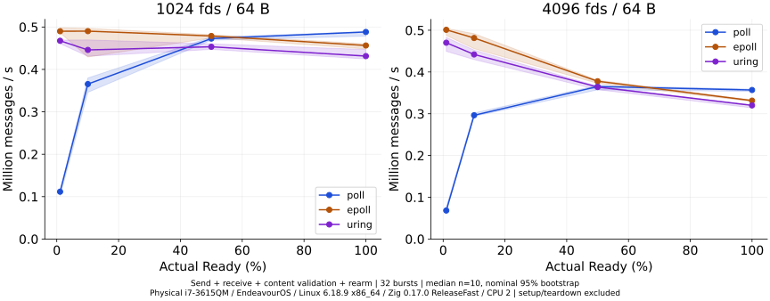
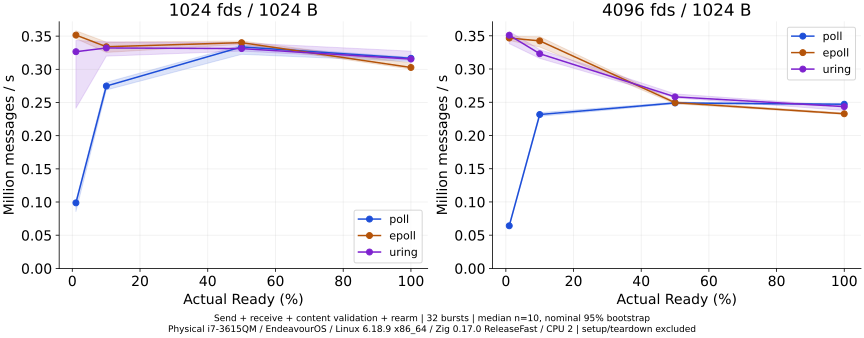
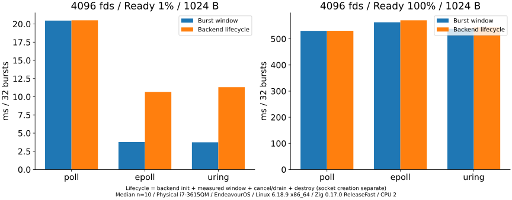
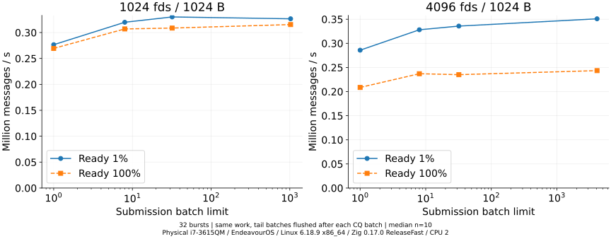
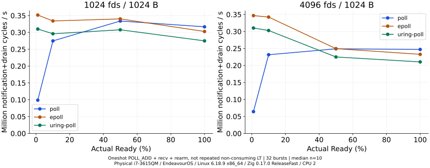

# Linux実機でのio_uring追試

実機（Intel Core i7-3615QM、EndeavourOS、Linux6.18.9-arch1-2、x86_64）で、直前のio_uring比較を再測定した。systemd-detect-virtはnone、CPU flagsにhypervisorはなく、DMIも保存した。

Zig0.17.0 ReleaseFast/native・libcなし、CPU2 affinity。CPU2/6はSMT siblingで専有しない。governor=schedutilのまま、周波数・温度・他負荷は固定していない。実際の測定SSHシェルではfdのsoft/hard上限がともに16384だった（実行前のSSH既定は1024/524288）。当初softのみ変更の計画だったが、Bashの`ulimit -n 16384`は両方へ適用された。変更は当該シェルと子プロセスに限定され、OS設定や別SSHセッションは変更していない。sudoやセキュリティ設定変更は行っていない。

## 測定条件

測定対象はpoll+recv、epoll LT+recv、io_uring RECV、oneshot POLL_ADD+recv。N64/256/1024/4096、Ready1/10/50/100%、64/1024B、32バースト×各10回。全warmupを先行し、seed・条件・実行順はVM系列と同じ。1520本測定と、batch64固定のSQ容量対照80本を別rawへ保存した。

Producerから全受信・内容検証・次回rearmまでがE2E。初期化・未完了要求cancel/終端CQE排出・破棄は別計時。Producer実装・Zigの受信処理・SQ/CQ管理はVM系列と同じで、将来のReady fd集合をRECV側へ渡さない。POLL_ADDは非消費LT再通知とは異なるため専用比較とする。

## 実機の結果

<!-- RESULTS -->
io_uringの機能確認と14件のZigテスト（rootを含む）、14条件×4方式のE2E検査が成功した。主系列本測定1520件・warmup152件、追加SQ容量対照80件・warmup8件。全方式で送受信byte数と内容を検証した。

RECV/epollのペア速度比中央値は**6/32条件で1を上回った**。backend初期化・終了込みの速度比中央値も6/32条件で1を上回ったが、該当する条件は同一とは限らない。多条件を調べた後の小差を一般的な優位や確認的有意差と呼ばない。

| Ready個数 | 方式 | msg/s中央値 | 名目95%区間 | backend初期化/終了込みmsg/s | プロセスCPU ms |
| --- | --- | --- | --- | --- | --- |
| 41 | poll | 64,116 | 63,003–65,569 | 63,994 | 20.319 |
| 41 | epoll | 346,623 | 342,975–349,345 | 123,023 | 3.882 |
| 41 | uring | 350,850 | 338,213–356,482 | 115,897 | 3.857 |
| 41 | uring-poll | 310,091 | 297,693–314,430 | 133,784 | 4.279 |
| 4096 | poll | 247,047 | 245,470–247,459 | 246,887 | 528.529 |
| 4096 | epoll | 232,678 | 231,676–233,985 | 229,594 | 560.254 |
| 4096 | uring | 243,430 | 237,630–244,557 | 240,979 | 536.008 |
| 4096 | uring-poll | 210,377 | 209,556–210,868 | 209,126 | 619.755 |

全Ready/4096fd/1024BでのRECV/epollペア速度比中央値は1.040（記述的95%区間1.024–1.051）、初期化・終了込みは1.045（1.028–1.054）。速度中央値同士の商とは異なる指標である。32条件を探索しており、一般的な勝敗へ拡張しない。低Ready4096fdではsteadyの比中央値は1.021だが区間は1を跨ぎ、初期化込みでは0.945となる。寿命や計測境界で結論が変わり得る。

### 全32条件のRECV/epoll比（同seed/run）

| N | Ready | B/msg | E2E速度比中央値 | 名目95%区間 | 初期化/終了込み比中央値 |
| --- | --- | --- | --- | --- | --- |
| 64 | 1 | 64 | 0.8636 | 0.7976–0.8953 | 0.7492 |
| 64 | 1 | 1024 | 0.9157 | 0.8754–0.9835 | 0.7317 |
| 64 | 7 | 64 | 0.9442 | 0.9133–0.9524 | 0.8907 |
| 64 | 7 | 1024 | 0.9417 | 0.9196–0.9582 | 0.8701 |
| 64 | 32 | 64 | 0.9228 | 0.7144–1.0255 | 0.9313 |
| 64 | 32 | 1024 | 0.9979 | 0.9691–1.0766 | 0.9702 |
| 64 | 64 | 64 | 0.9635 | 0.9131–1.0167 | 0.9633 |
| 64 | 64 | 1024 | 0.9795 | 0.9547–1.0190 | 0.9699 |
| 256 | 3 | 64 | 0.8632 | 0.8143–0.9426 | 0.9014 |
| 256 | 3 | 1024 | 0.9293 | 0.8733–0.9695 | 0.8047 |
| 256 | 26 | 64 | 0.9891 | 0.8363–1.3066 | 0.9730 |
| 256 | 26 | 1024 | 0.9790 | 0.8225–1.0240 | 0.9211 |
| 256 | 128 | 64 | 0.9757 | 0.9297–1.0093 | 0.9805 |
| 256 | 128 | 1024 | 1.0136 | 0.9849–1.0476 | 1.0101 |
| 256 | 256 | 64 | 0.9670 | 0.9483–0.9792 | 0.9717 |
| 256 | 256 | 1024 | 1.0064 | 0.9697–1.0193 | 1.0027 |
| 1024 | 11 | 64 | 0.9511 | 0.9401–0.9592 | 0.9806 |
| 1024 | 11 | 1024 | 0.9464 | 0.6967–0.9843 | 0.8147 |
| 1024 | 103 | 64 | 0.9495 | 0.9200–0.9988 | 0.9684 |
| 1024 | 103 | 1024 | 0.9859 | 0.9601–1.0339 | 0.9568 |
| 1024 | 512 | 64 | 0.9508 | 0.9389–0.9602 | 0.9609 |
| 1024 | 512 | 1024 | 0.9675 | 0.9576–1.0035 | 0.9679 |
| 1024 | 1024 | 64 | 0.9544 | 0.9382–0.9832 | 0.9586 |
| 1024 | 1024 | 1024 | 1.0501 | 1.0281–1.0599 | 1.0521 |
| 4096 | 41 | 64 | 0.9435 | 0.9049–0.9852 | 1.0157 |
| 4096 | 41 | 1024 | 1.0213 | 0.9795–1.0351 | 0.9449 |
| 4096 | 410 | 64 | 0.9092 | 0.8939–0.9683 | 0.9540 |
| 4096 | 410 | 1024 | 0.9382 | 0.9208–0.9790 | 0.9507 |
| 4096 | 2048 | 64 | 0.9570 | 0.9488–0.9683 | 0.9672 |
| 4096 | 2048 | 1024 | 1.0423 | 1.0265–1.0544 | 1.0433 |
| 4096 | 4096 | 64 | 0.9668 | 0.9477–0.9734 | 0.9753 |
| 4096 | 4096 | 1024 | 1.0401 | 1.0241–1.0508 | 1.0453 |

比>1はRECVが速い方向。全方式の絶対値・最小最大・CPU user/system・区間時間はsummary.csvに全条件保存した。

### 初期化と終了

| Ready | 方式 | backend初期化 ms | setup ms | mmap ms | 初期投入 ms | cancel/排出 ms | 破棄 ms |
| --- | --- | --- | --- | --- | --- | --- | --- |
| 41 | poll | 0.038 | 0.000 | 0.000 | 0.000 | 0.000 | 0.001 |
| 41 | epoll | 5.352 | 0.000 | 0.000 | 0.000 | 0.000 | 1.484 |
| 41 | uring | 4.618 | 0.119 | 0.040 | 3.415 | 2.743 | 0.161 |
| 41 | uring-poll | 3.332 | 0.117 | 0.039 | 2.144 | 2.026 | 0.157 |
| 4096 | poll | 0.040 | 0.000 | 0.000 | 0.000 | 0.000 | 0.001 |
| 4096 | epoll | 5.265 | 0.000 | 0.000 | 0.000 | 0.000 | 2.230 |
| 4096 | uring | 5.239 | 0.121 | 0.041 | 3.374 | 0.012 | 0.175 |
| 4096 | uring-poll | 3.441 | 0.119 | 0.041 | 2.110 | 0.016 | 0.198 |

列は各区間の中央値であり、加算して総時間を復元しない。socket生成は共通の別区間。未到着要求は毎バーストキャンセルせず、最後に受付CQEと対象終端CQEを回収してからbufferを解放する。

### バッチ・CQ・SQ対照

| N | Ready | variant | msg/s | E2E enter | CPU ms |
| --- | --- | --- | --- | --- | --- |
| 1024 | 11 | baseline | 326,542 | 31 | 1.107 |
| 1024 | 1024 | baseline | 315,413 | 31 | 103.326 |
| 4096 | 41 | baseline | 350,850 | 31 | 3.857 |
| 4096 | 4096 | baseline | 243,430 | 31 | 536.008 |
| 1024 | 11 | batch-1 | 276,585 | 341 | 1.266 |
| 1024 | 11 | batch-8 | 319,861 | 62 | 1.131 |
| 1024 | 11 | batch-32 | 330,099 | 31 | 1.093 |
| 1024 | 11 | cq-1 | 278,486 | 341 | 1.289 |
| 1024 | 11 | cq-64 | 325,811 | 31 | 1.104 |
| 1024 | 11 | sq-64 | 324,461 | 31 | 1.098 |
| 1024 | 1024 | batch-1 | 269,370 | 31744 | 120.511 |
| 1024 | 1024 | batch-8 | 306,981 | 3968 | 105.473 |
| 1024 | 1024 | batch-32 | 308,621 | 992 | 105.138 |
| 1024 | 1024 | cq-1 | 254,277 | 31744 | 127.742 |
| 1024 | 1024 | cq-64 | 315,162 | 496 | 102.802 |
| 1024 | 1024 | sq-64 | 310,602 | 496 | 104.278 |
| 4096 | 41 | batch-1 | 285,814 | 1271 | 4.704 |
| 4096 | 41 | batch-8 | 328,124 | 186 | 4.109 |
| 4096 | 41 | batch-32 | 335,759 | 62 | 4.007 |
| 4096 | 41 | cq-1 | 273,198 | 1271 | 4.900 |
| 4096 | 41 | cq-64 | 338,922 | 31 | 3.946 |
| 4096 | 41 | sq-64 | 344,404 | 31 | 3.877 |
| 4096 | 4096 | batch-1 | 208,541 | 126976 | 626.222 |
| 4096 | 4096 | batch-8 | 236,989 | 15872 | 551.039 |
| 4096 | 4096 | batch-32 | 235,013 | 3968 | 554.918 |
| 4096 | 4096 | cq-1 | 203,967 | 126976 | 639.746 |
| 4096 | 4096 | cq-64 | 242,007 | 1984 | 538.453 |
| 4096 | 4096 | sq-64 | 237,738 | 1984 | 549.202 |

全Ready/4096fd/1024B、batch1→最大でenter126976→31回、0.209→0.243 Mmsg/s、プロセスCPU626.223→536.008ms。投入削減とCPU/速度改善を確認したが、最大batchが常に最速という意味ではない。CQ回収上限は再投入の端数flush頻度にも影響するため、コピー単体の費用差とは解釈しない。

| N | Ready | batch64固定 SQ64/N速度比 | 名目95%区間 |
| --- | --- | --- | --- |
| 1024 | 11 | 1.0251 | 0.9095–1.7383 |
| 1024 | 1024 | 0.9914 | 0.9653–1.0137 |
| 4096 | 41 | 1.0045 | 0.9405–1.0668 |
| 4096 | 4096 | 0.9929 | 0.9721–1.0071 |

SQ容量だけを変えた対照の全区間は1を跨いだ。この系列では明確な優位を確認しない。SQより多数の未完了要求を保持する設計は実機4096fdでも通過した。

### POLL_ADDとsyscall経路

oneshotの再投入込みであり、既存Aの非消費LT再通知とは比べない。別strace12実行で、x86_64のpoll/epoll_wait/recvfromとio_uring_enterの件数を内部カウンタと照合した。setup/mmap/registerの最小プログラムtraceも保存した。

<!-- /RESULTS -->

## OrbStackとの比較上の注意

VMデータは変更せず、実機データと集計を混ぜていない。今回の差にはCPU（Apple M2 / Intel Ivy Bridge）、アーキテクチャ（aarch64 / x86_64）、Linux版、nativeターゲット、SMT、周波数制御などが同時に含まれる。速度差を「仮想化のオーバーヘッド」とだけ説明することはできない。

syscallの名前もaarch64とx86_64では異なる。strace解析はpoll/ppollとepoll_wait/epoll_pwaitを区別して合算する。strace下の時間は性能値へ混ぜない。CPUはgetrusageのプロセス時間であり、ホストやkernel worker全体のCPUと同一視しない。

## 再現性と範囲

同一系列内の10回の中央値・最小最大・記述的bootstrap区間を保存。別日の反復や別の物理機は未実施。有限・送信先行の単一スレッドバーストで、継続到着、TCP/TLS/Web処理、SQPOLL、multishot、registered resourcesの結果ではない。過去のKerrisk/Adaptive系列を実機で再測定したとは扱わない。

## 再実行

READMEの実機実行手順を参照。raw/環境/source snapshot/実行順/CSV/SVGをresults/physical-20261022に保存した。過去のresultsはpreserved-results.jsonで指紋を検証する。

## 品質確認

主系列1520件・容量対照80件・warmup160件の内容/件数/指紋を検証し、過去の結果173ファイルを保持した。実機でZigの正しさテスト、独立strace、集計を実行した。SlidevはMacと実機でビルド成功、実機上のブラウザー表示検査・PDF出力も成功。PDF全23ページと5つのSVGを目視確認し、はみ出し・色対応・クリック・発表者ノートを確認した。[品質記録](results/physical-20261022/quality.json)を参照。
