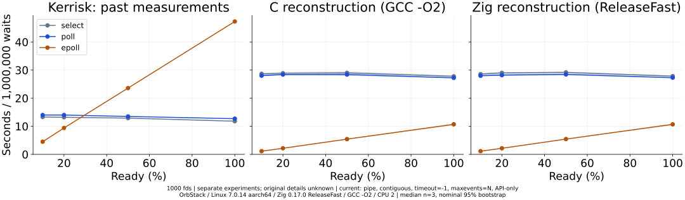
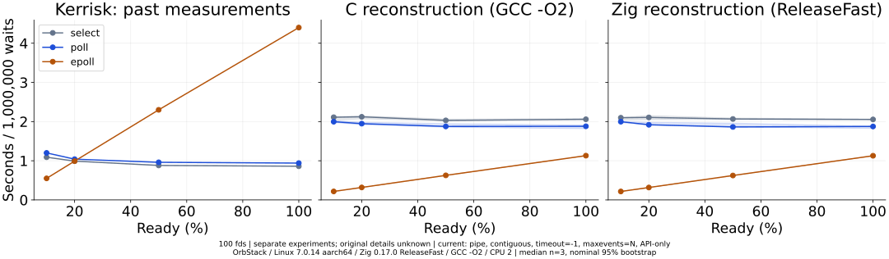
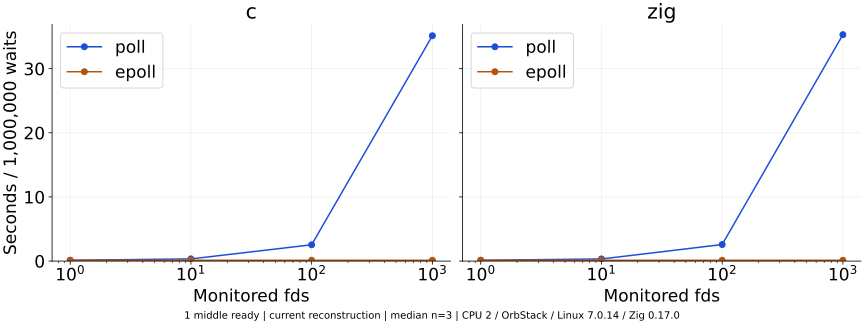
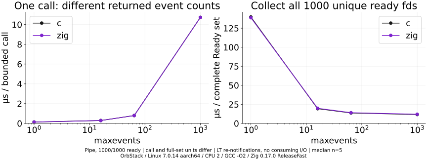
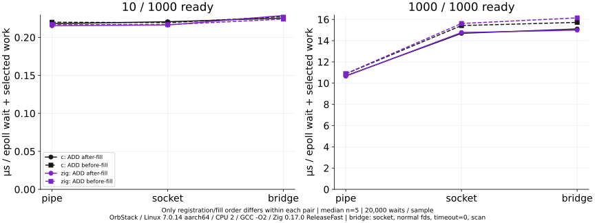
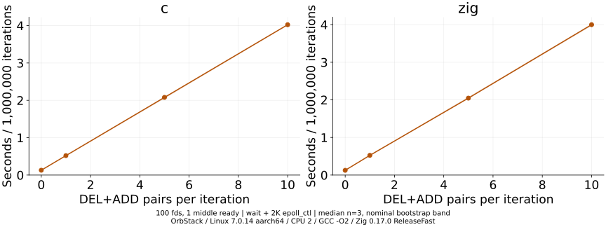

# Kerrisk氏のpoll/epoll比較：公開仕様からの再構成実験

## 1. Kerrisk氏の実験概要

複数のpipe等を作り、一部へデータを入れ、消費せずselect/poll/epollを繰り返す合成負荷を追試した。接続数・Ready率・監視集合更新の影響を調べるもので、本番Webサーバのスループット測定ではない。

原典のA/B/Cは100万回。今回もこの反復数を維持し、CとZigを同一条件で比較する。反転や特定の方式の勝利を成功条件にしない。

## 2. 原典ソースの入手状況

公式TLPI配布版`tlpi-260523-dist.tar.gz`を取得したが`altio/altio_speed.c`は含まれず、公開候補URLでも見つからなかった。詳細、入手先、SHA-256、ライセンス確認は[SOURCES.md](SOURCES.md)に保存した。

従って**元ソースの無改変実行による厳密再現ではない**。本CコードをKerrisk氏のオリジナルと呼ばない。pipe、Ready生成、低位連続fd、反復数など公開された仕様を揃え、timeout=-1、maxevents=N、走査なしなど未知の部分は仮定を明記した。別対照でその影響も調べる。

## 3. 元の測定結果

<!-- HISTORICAL_RESULTS -->
原典の秒数（いずれも100万監視操作）。信頼区間・sample数は未確認。

| 比較 | N | Ready | 方式 | K | 過去の秒数 |
| --- | --- | --- | --- | --- | --- |
| A | 100 | 10 | select | 0 | 1.09 |
| A | 100 | 10 | poll | 0 | 1.2 |
| A | 100 | 10 | epoll | 0 | 0.55 |
| A | 100 | 20 | select | 0 | 0.99 |
| A | 100 | 20 | poll | 0 | 1.04 |
| A | 100 | 20 | epoll | 0 | 0.99 |
| A | 100 | 50 | select | 0 | 0.88 |
| A | 100 | 50 | poll | 0 | 0.96 |
| A | 100 | 50 | epoll | 0 | 2.3 |
| A | 100 | 100 | select | 0 | 0.86 |
| A | 100 | 100 | poll | 0 | 0.94 |
| A | 100 | 100 | epoll | 0 | 4.4 |
| A | 1000 | 100 | select | 0 | 13.3 |
| A | 1000 | 100 | poll | 0 | 14.0 |
| A | 1000 | 100 | epoll | 0 | 4.5 |
| A | 1000 | 200 | select | 0 | 13.2 |
| A | 1000 | 200 | poll | 0 | 14.0 |
| A | 1000 | 200 | epoll | 0 | 9.4 |
| A | 1000 | 500 | select | 0 | 12.9 |
| A | 1000 | 500 | poll | 0 | 13.5 |
| A | 1000 | 500 | epoll | 0 | 23.6 |
| A | 1000 | 1000 | select | 0 | 11.8 |
| A | 1000 | 1000 | poll | 0 | 12.7 |
| A | 1000 | 1000 | epoll | 0 | 47.3 |
| B | 1 | 1 | select | 0 | 0.23 |
| B | 1 | 1 | poll | 0 | 0.19 |
| B | 1 | 1 | epoll | 0 | 0.16 |
| B | 10 | 1 | select | 0 | 0.48 |
| B | 10 | 1 | poll | 0 | 0.46 |
| B | 10 | 1 | epoll | 0 | 0.16 |
| B | 100 | 1 | select | 0 | 2.78 |
| B | 100 | 1 | poll | 0 | 3.18 |
| B | 100 | 1 | epoll | 0 | 0.16 |
| B | 1000 | 1 | select | 0 | 30.0 |
| B | 1000 | 1 | poll | 0 | 36.4 |
| B | 1000 | 1 | epoll | 0 | 0.16 |
| C | 100 | 1 | epoll | 0 | 0.16 |
| C | 100 | 1 | epoll | 1 | 0.69 |
| C | 100 | 1 | epoll | 5 | 2.8 |
| C | 100 | 1 | epoll | 10 | 5.4 |

<!-- /HISTORICAL_RESULTS -->

講義資料の版はJanuary 2026 / d49d0b54be95だが、表にある測定の実施日時・CPU・kernel・コンパイラは未確認。過去の参考値を現在と同条件の系列として線で結ばない。

## 4. Cによる再構成

CはGCCの-O2でビルド。stdioなどを含む一般的なglibcのAPIを使う。N組のpipeまたはsocketpairを作り、read側を低位連続fd 3..N+2へ配置する。全writerを高位で保持してEOFを防ぎ、Ready対象へ1 byteを入れた後は消費しない。

元の開始fd番号やRNGは不明であり、3からの開始と共通xorshift64/Fisher-Yatesは再構成側の選択。C/ZigのReady bitmap hash、実際のReady集合、返却件数、fd範囲を照合した。主比較のC索引配列はint32、Zigはusize64だが、主比較の計時区間には索引走査を含まない。対照を測る前にはC側をsize_tへ揃え、両言語に事前取得結果検証のcompiler barrierを追加した。版ごとのソースと指紋を保存し、主比較の既存データは置換しない。

初期登録・生成・初回の全Ready集合確認を計時外とし、ループ全体をMONOTONICで囲む。主比較の区間はAPI＋返却件数確認・checksum。Cのイベント配列走査を含むか否かを原典ソースで確認できていないので、これを忠実な内部実装の再現とはしない。

<!-- C_RESULTS -->
原典相当のA/B/C、100万反復、中央値と名目95% bootstrap区間（秒）、各3 sample。

| 比較 | N | Ready | 方式 | K | 秒 中央値 | 95%区間 |
| --- | --- | --- | --- | --- | --- | --- |
| A | 100 | 10 | select | 0 | 2.111 | 2.033–2.128 |
| A | 100 | 10 | poll | 0 | 1.996 | 1.975–2.024 |
| A | 100 | 10 | epoll | 0 | 0.217 | 0.216–0.217 |
| A | 100 | 20 | select | 0 | 2.122 | 2.070–2.146 |
| A | 100 | 20 | poll | 0 | 1.947 | 1.920–1.983 |
| A | 100 | 20 | epoll | 0 | 0.318 | 0.317–0.321 |
| A | 100 | 50 | select | 0 | 2.030 | 2.016–2.066 |
| A | 100 | 50 | poll | 0 | 1.876 | 1.855–1.949 |
| A | 100 | 50 | epoll | 0 | 0.627 | 0.620–0.628 |
| A | 100 | 100 | select | 0 | 2.059 | 2.041–2.077 |
| A | 100 | 100 | poll | 0 | 1.880 | 1.817–1.913 |
| A | 100 | 100 | epoll | 0 | 1.130 | 1.128–1.133 |
| A | 1000 | 100 | select | 0 | 28.676 | 28.452–28.785 |
| A | 1000 | 100 | poll | 0 | 28.015 | 27.867–28.397 |
| A | 1000 | 100 | epoll | 0 | 1.141 | 1.139–1.143 |
| A | 1000 | 200 | select | 0 | 28.878 | 28.307–29.202 |
| A | 1000 | 200 | poll | 0 | 28.404 | 28.378–28.464 |
| A | 1000 | 200 | epoll | 0 | 2.171 | 2.171–2.187 |
| A | 1000 | 500 | select | 0 | 29.016 | 28.727–29.429 |
| A | 1000 | 500 | poll | 0 | 28.402 | 28.077–28.723 |
| A | 1000 | 500 | epoll | 0 | 5.427 | 5.423–5.444 |
| A | 1000 | 1000 | select | 0 | 27.783 | 27.778–28.063 |
| A | 1000 | 1000 | poll | 0 | 27.241 | 27.232–27.312 |
| A | 1000 | 1000 | epoll | 0 | 10.703 | 10.437–10.803 |
| B | 1 | 1 | poll | 0 | 0.127 | 0.127–0.127 |
| B | 1 | 1 | epoll | 0 | 0.129 | 0.126–0.130 |
| B | 10 | 1 | poll | 0 | 0.343 | 0.337–0.357 |
| B | 10 | 1 | epoll | 0 | 0.130 | 0.129–0.130 |
| B | 100 | 1 | poll | 0 | 2.546 | 2.522–2.610 |
| B | 100 | 1 | epoll | 0 | 0.130 | 0.129–0.134 |
| B | 1000 | 1 | poll | 0 | 35.137 | 35.105–35.299 |
| B | 1000 | 1 | epoll | 0 | 0.129 | 0.129–0.129 |
| C | 100 | 1 | epoll | 0 | 0.130 | 0.130–0.130 |
| C | 100 | 1 | epoll | 1 | 0.521 | 0.517–0.523 |
| C | 100 | 1 | epoll | 5 | 2.079 | 2.055–2.082 |
| C | 100 | 1 | epoll | 10 | 4.024 | 4.017–4.031 |

<!-- /C_RESULTS -->

## 5. Zigによる再構成と公平性

Zig **0.17.0 / ReleaseFast**を使用。fd生成、Ready集合、fd番号、イベント容量、timeout、ループ数、処理予算、更新対象の循環式、計時境界をCと揃えた。selectはstd.os.linuxのsyscall6(.pselect6, ...)を使用する。Cはglibcラッパー、ZigはLinuxラッパーなので、syscallに入るまでの処理や最適化は完全には同じでない。GCC既定のCPUターゲットとZig既定のnativeターゲットも明示的に同等化していないため、小差を言語そのものの効果に帰属させない。

両実装は結果をchecksumとして出力し、返却件数と全Ready集合の照合を実行する。C/ZigのAPI呼出し回数、取得イベント数、登録変更回数を照合した。CのASan/UBSanとZig Debugを含む171シナリオの正しさテストを実施。速い/遅いことを合否条件にしていない。

<!-- ZIG_RESULTS -->
原典相当のA/B/C、100万反復、中央値と名目95% bootstrap区間（秒）、各3 sample。

| 比較 | N | Ready | 方式 | K | 秒 中央値 | 95%区間 |
| --- | --- | --- | --- | --- | --- | --- |
| A | 100 | 10 | select | 0 | 2.098 | 2.033–2.109 |
| A | 100 | 10 | poll | 0 | 1.997 | 1.973–2.002 |
| A | 100 | 10 | epoll | 0 | 0.216 | 0.214–0.219 |
| A | 100 | 20 | select | 0 | 2.106 | 2.049–2.154 |
| A | 100 | 20 | poll | 0 | 1.919 | 1.914–1.982 |
| A | 100 | 20 | epoll | 0 | 0.317 | 0.315–0.317 |
| A | 100 | 50 | select | 0 | 2.066 | 2.051–2.092 |
| A | 100 | 50 | poll | 0 | 1.863 | 1.862–1.961 |
| A | 100 | 50 | epoll | 0 | 0.623 | 0.617–0.623 |
| A | 100 | 100 | select | 0 | 2.055 | 2.041–2.059 |
| A | 100 | 100 | poll | 0 | 1.875 | 1.824–1.887 |
| A | 100 | 100 | epoll | 0 | 1.127 | 1.127–1.130 |
| A | 1000 | 100 | select | 0 | 28.562 | 28.561–28.986 |
| A | 1000 | 100 | poll | 0 | 27.969 | 27.937–28.168 |
| A | 1000 | 100 | epoll | 0 | 1.137 | 1.132–1.139 |
| A | 1000 | 200 | select | 0 | 29.014 | 28.227–29.167 |
| A | 1000 | 200 | poll | 0 | 28.197 | 28.136–28.496 |
| A | 1000 | 200 | epoll | 0 | 2.164 | 2.163–2.171 |
| A | 1000 | 500 | select | 0 | 29.177 | 28.671–29.380 |
| A | 1000 | 500 | poll | 0 | 28.465 | 28.214–28.558 |
| A | 1000 | 500 | epoll | 0 | 5.443 | 5.442–5.450 |
| A | 1000 | 1000 | select | 0 | 27.850 | 27.769–27.999 |
| A | 1000 | 1000 | poll | 0 | 27.303 | 27.150–27.309 |
| A | 1000 | 1000 | epoll | 0 | 10.698 | 10.442–10.748 |
| B | 1 | 1 | poll | 0 | 0.125 | 0.124–0.125 |
| B | 1 | 1 | epoll | 0 | 0.127 | 0.127–0.127 |
| B | 10 | 1 | poll | 0 | 0.335 | 0.334–0.336 |
| B | 10 | 1 | epoll | 0 | 0.127 | 0.127–0.128 |
| B | 100 | 1 | poll | 0 | 2.584 | 2.537–2.604 |
| B | 100 | 1 | epoll | 0 | 0.127 | 0.127–0.128 |
| B | 1000 | 1 | poll | 0 | 35.303 | 35.147–35.314 |
| B | 1000 | 1 | epoll | 0 | 0.127 | 0.126–0.129 |
| C | 100 | 1 | epoll | 0 | 0.127 | 0.127–0.127 |
| C | 100 | 1 | epoll | 1 | 0.525 | 0.517–0.527 |
| C | 100 | 1 | epoll | 5 | 2.047 | 2.045–2.069 |
| C | 100 | 1 | epoll | 10 | 3.999 | 3.975–4.005 |

### Q1：高Ready率の逆転

今回の主比較Aでは、両言語・全N/Ready率でpollの費用中央値がepollを上回り、原典の高Ready率でのpoll逆転を再現しなかった。これは再構成と今回のVMの範囲に限る。元ソース未入手なので、厳密な原典再現の成功/失敗とは別である。
| 言語 | N | Ready | poll/epoll費用比 | 95%区間 | pollが速いrun |
| --- | --- | --- | --- | --- | --- |
| c | 100 | 10 | 9.224 | 9.108–9.345 | 0/3 |
| c | 100 | 20 | 6.120 | 5.973–6.260 | 0/3 |
| c | 100 | 50 | 2.992 | 2.953–3.142 | 0/3 |
| c | 100 | 100 | 1.663 | 1.603–1.695 | 0/3 |
| c | 1000 | 100 | 24.516 | 24.428–24.942 | 0/3 |
| c | 1000 | 200 | 13.073 | 12.986–13.112 | 0/3 |
| c | 1000 | 500 | 5.233 | 5.157–5.297 | 0/3 |
| c | 1000 | 1000 | 2.552 | 2.521–2.610 | 0/3 |
| zig | 100 | 10 | 9.145 | 9.138–9.314 | 0/3 |
| zig | 100 | 20 | 6.083 | 6.047–6.258 | 0/3 |
| zig | 100 | 50 | 3.017 | 2.988–3.146 | 0/3 |
| zig | 100 | 100 | 1.664 | 1.618–1.669 | 0/3 |
| zig | 1000 | 100 | 24.672 | 24.607–24.733 | 0/3 |
| zig | 1000 | 200 | 13.000 | 12.989–13.177 | 0/3 |
| zig | 1000 | 500 | 5.230 | 5.184–5.240 | 0/3 |
| zig | 1000 | 1000 | 2.552 | 2.526–2.615 | 0/3 |

原典の公表点では50%と100%でpollが逆転しているが、正確な閾値を連続的に測った表ではない。全Readyでは100 fdでpoll/epoll=0.214、1000 fdで0.268。今回の全点の比と上表で比較する。逆転の有無だけでなく、Ready率に対する曲線と差の規模も異なり得る。

### Q2：CとZigの傾向

主比較Aのpoll対epollの優劣方向は全条件でCとZigが一致した。現行のこの条件では、Zig化だけを過去との差の原因とする説明を支持しない。各条件のZig/Cペア比はanalysis.jsonのlanguage_pairsに全件保存した。APIラッパー・コンパイラ最適化・検査コードが完全同一ではなく、これを言語の優位性の測定としない。

<!-- /ZIG_RESULTS -->

## 6. 既存のZig実験との差

| 項目 | 講義からの再構成 | 既存ベンチマーク |
|---|---|---|
| fd | 主比較はblocking pipe | non-blocking Unix socketpair |
| 番号 | read fd 3..N+2へ明示配置 | 通常割り当て（およそ1個飛ばし） |
| Ready | xorshift64/Fisher-Yates、sparseは中間 | Zig DefaultPrngの順列 |
| N | 100/1000など | 64/256/1024/4096など |
| timeout | 主比較は-1の仮定、0も別対照 | 0 |
| maxevents | 主比較はN、上限比較を別実施 | N |
| イベントマスク | EPOLLIN | INとRDHUP |
| 定常区間 | 主比較はAPI＋件数検査 | API＋索引変換、計時・Stats操作もあり |
| Ready集合検証 | 主比較は事前検証、区間別対照あり | Aのacquisition外、duration内 |
| データ量 | 1 byte投入、消費しない | Aは64 B等を投入、Bは実際に受信 |
| 登録 | データ投入後の初期ADD、実験Cでは毎回K組DEL+ADD | 初期ADD後に投入、Adaptiveはclose/再登録 |
| 時計 | ループ全体の両端 | 既存Aの取得区間は各反復でも計時 |

新しい`existing-api`/`existing-scan`ラベルは、既存に条件を近づける橋渡し対照であり、既存そのものではない。blockingフラグ、データ量、N、RNG、マスク、細かなエラー検査等の差は残る。N=1000と既存N=1024の時間を同じ条件として差し引かない。

<!-- FACTOR_RESULTS -->
### Q3：一要因ずつの橋渡し対照

N=1000、短いループを各5回。下表はZig側の全橋渡し点で、µs/待機呼び出し。同じN/Ready集合で比較し、C側もsummary.csvへ全件保存した。

| Ready | 方式 | 段階 | µs/回 | 95%区間 |
| --- | --- | --- | --- | --- |
| 10 | poll | baseline | 28.864 | 27.856–30.898 |
| 10 | epoll | baseline | 0.216 | 0.215–0.218 |
| 10 | poll | socket | 42.483 | 41.196–44.235 |
| 10 | epoll | socket | 0.217 | 0.215–0.220 |
| 10 | poll | socket-normal | 42.450 | 41.424–44.133 |
| 10 | epoll | socket-normal | 0.219 | 0.215–0.221 |
| 10 | poll | existing-api | 41.544 | 40.663–41.864 |
| 10 | epoll | existing-api | 0.218 | 0.217–0.223 |
| 10 | poll | existing-scan | 41.820 | 40.401–42.311 |
| 10 | epoll | existing-scan | 0.227 | 0.221–0.228 |
| 1000 | poll | baseline | 27.384 | 27.155–27.693 |
| 1000 | epoll | baseline | 10.728 | 10.354–10.983 |
| 1000 | poll | socket | 41.057 | 40.227–41.645 |
| 1000 | epoll | socket | 14.399 | 14.288–15.184 |
| 1000 | poll | socket-normal | 41.367 | 40.469–41.584 |
| 1000 | epoll | socket-normal | 14.587 | 14.412–15.263 |
| 1000 | poll | existing-api | 41.401 | 40.319–41.502 |
| 1000 | epoll | existing-api | 14.558 | 14.476–14.917 |
| 1000 | poll | existing-scan | 41.507 | 40.599–42.260 |
| 1000 | epoll | existing-scan | 14.989 | 14.546–15.655 |

順序はpipe/contiguous/-1/API → socket/contiguous/-1/API → socket/normal/-1/API → socket/normal/0/API → socket/normal/0/scan。各隣接点は1条件だけ変更する。これだけで元の既存実装と完全一致したとはしない。直接のtimeout/走査/検証対照もsummary.csvに残す。

### maxevents：異なる量の仕事を区別

| 言語 | work | 容量 | µs/単位 | 待機回数/単位 | イベント数/単位 |
| --- | --- | --- | --- | --- | --- |
| c | api | 1 | 0.139 | 1.0 | 1.0 |
| zig | api | 1 | 0.136 | 1.0 | 1.0 |
| c | full | 1 | 139.736 | 1000.0 | 1000.0 |
| zig | full | 1 | 138.751 | 1000.0 | 1000.0 |
| c | api | 16 | 0.294 | 1.0 | 16.0 |
| zig | api | 16 | 0.290 | 1.0 | 16.0 |
| c | full | 16 | 19.275 | 63.0 | 1008.0 |
| zig | full | 16 | 19.858 | 63.0 | 1008.0 |
| c | api | 64 | 0.796 | 1.0 | 64.0 |
| zig | api | 64 | 0.792 | 1.0 | 64.0 |
| c | full | 64 | 13.686 | 16.0 | 1024.0 |
| zig | full | 64 | 14.050 | 16.0 | 1024.0 |
| c | api | 1000 | 10.727 | 1.0 | 1000.0 |
| zig | api | 1000 | 10.722 | 1.0 | 1000.0 |
| c | full | 1000 | 11.637 | 1.0 | 1000.0 |
| zig | full | 1000 | 12.024 | 1.0 | 1000.0 |

単発APIでは容量1と1000で返すイベント数が違う。fullは1000個すべてのReady対象を集める同量の仕事であり、単位・繰り返し回数が異なる。単発の低コストを全Ready集合の高速化と誤認しない。

### 走査と集合検証

| Ready | 方式 | work | ns/その区間の1反復 | 反復 |
| --- | --- | --- | --- | --- |
| 10 | poll | api | 28863.7 | 20000 |
| 10 | epoll | api | 215.9 | 20000 |
| 10 | poll | scan | 29414.3 | 20000 |
| 10 | epoll | scan | 222.0 | 20000 |
| 10 | poll | verify | 29837.6 | 20000 |
| 10 | epoll | verify | 252.3 | 20000 |
| 10 | poll | scan-only | 593.2 | 100000 |
| 10 | epoll | scan-only | 7.4 | 100000 |
| 10 | poll | verify-only | 28.3 | 100000 |
| 10 | epoll | verify-only | 28.0 | 100000 |
| 1000 | poll | api | 27383.7 | 20000 |
| 1000 | epoll | api | 10727.5 | 20000 |
| 1000 | poll | scan | 27870.1 | 20000 |
| 1000 | epoll | scan | 11035.7 | 20000 |
| 1000 | poll | verify | 28981.6 | 20000 |
| 1000 | epoll | verify | 11939.9 | 20000 |
| 1000 | poll | scan-only | 468.2 | 100000 |
| 1000 | epoll | scan-only | 311.6 | 100000 |
| 1000 | poll | verify-only | 887.1 | 100000 |
| 1000 | epoll | verify-only | 888.8 | 100000 |

api/scan/verifyはそれぞれ待機を含む。scan-only/verify-onlyは事前取得結果を繰り返す別ループで、キャッシュ状態も異なる。独立した中央値の差を厳密な加法分解にしない。

### 登録と投入の順序：追加の一要因対照

主測定と上の対照ではデータ投入後にADDするため、Ready Listの初期順序は登録順となる。既存の実装はADD後にランダムに投入する。この差を静的監査で発見したため、別planを固定し、登録/投入の順だけを変える追加対照を行った。元のCがどちらかは未確認。各20,000反復・5 sample、両言語の全条件を示す。

| 言語 | 条件 | Ready | ADDの時点 | µs/回 | 名目95%区間 |
| --- | --- | --- | --- | --- | --- |
| c | pipe | 10 | after-fill | 0.218 | 0.217–0.221 |
| zig | pipe | 10 | after-fill | 0.215 | 0.214–0.215 |
| c | pipe | 10 | before-fill | 0.220 | 0.218–0.222 |
| zig | pipe | 10 | before-fill | 0.217 | 0.214–0.218 |
| c | socket | 10 | after-fill | 0.221 | 0.219–0.222 |
| zig | socket | 10 | after-fill | 0.216 | 0.215–0.220 |
| c | socket | 10 | before-fill | 0.219 | 0.219–0.222 |
| zig | socket | 10 | before-fill | 0.217 | 0.216–0.218 |
| c | bridge | 10 | after-fill | 0.225 | 0.225–0.234 |
| zig | bridge | 10 | after-fill | 0.229 | 0.222–0.246 |
| c | bridge | 10 | before-fill | 0.227 | 0.224–0.229 |
| zig | bridge | 10 | before-fill | 0.224 | 0.223–0.224 |
| c | pipe | 1000 | after-fill | 10.690 | 10.641–11.049 |
| zig | pipe | 1000 | after-fill | 10.659 | 10.342–10.820 |
| c | pipe | 1000 | before-fill | 10.877 | 10.725–10.951 |
| zig | pipe | 1000 | before-fill | 10.886 | 10.706–11.304 |
| c | socket | 1000 | after-fill | 14.689 | 14.557–14.838 |
| zig | socket | 1000 | after-fill | 14.769 | 14.502–15.107 |
| c | socket | 1000 | before-fill | 15.420 | 15.289–16.030 |
| zig | socket | 1000 | before-fill | 15.619 | 15.262–15.840 |
| c | bridge | 1000 | after-fill | 15.103 | 14.777–15.315 |
| zig | bridge | 1000 | after-fill | 14.988 | 14.916–15.326 |
| c | bridge | 1000 | before-fill | 15.720 | 15.545–16.387 |
| zig | bridge | 1000 | before-fill | 16.143 | 15.961–16.398 |

after-fillは投入後ADD（登録順）、before-fillは投入前ADD（ランダム通知順）。計時外の事前取得列のhashを独立したPython実装で照合し、集合は同じだが列の順序が変わることも確認した。生成したC/Zigソース・差分・SHAとコマンドはregistration-source/とregistration-environment.jsonへ保存した。

全Readyのsocket/bridgeではランダム通知順の中央値が上昇した。pipeでは差が小さく区間も重なる。キャッシュmissを直接測ったものではないため内部原因までは特定しない。この介入はepollのみの短い対照で、過去のpoll逆転や既存End-to-End全体の差を説明し切ったものではない。

<!-- /FACTOR_RESULTS -->

## 7. 性能差が生じた原因候補

ZigのN1000/R1では、timeout=-1の先頭/中間/末尾が27.373/35.532/44.020 µs/回、timeout=0では27.363/27.571/27.556 µs/回だった。後者では位置による大きな傾きが消えた。この実験では、位置とtimeoutの組み合わせが費用へ影響することを確認できた。

原典ソース、過去の機器・kernel・最適化が不明なので、過去と現在の差を単一原因に帰属できない。CPU/メモリ特性、kernel内の実装、APIラッパー、Ready配置、イベント走査、配列サイズなどが候補となる。

上流Linux stable v7.0.14のfs/select.cでは、timeout=0のときpoll_tableの登録callbackを無効化する。非ゼロ待機では最初のReady対象を見つけるまでの待機登録があり、見つけた後にcallbackを止める。従って「最初に見つかるReady対象の位置」と「timeout」の組み合わせには検証すべき差がある。単にpollが最初のReady fdで全走査を終了するという意味ではない。

この参照は測定版と同じベース版だが、OrbStack独自patchとの完全一致は未確認。キャッシュmissやkernel内の各関数のCPU時間を直接測った実験ではなく、その因果を特定してはいない。

## 8. 確認できた事項と登録更新費用

主比較の全Ready/1000 fdでは、Zigのpollは27.303秒、epollは10.698秒/100万回（中央値各3回）。K=0からK=10で、100 fd/1 Readyのepollループは0.127秒から3.999秒へ増加した。更新費用は現在のVMでも総費用を大きく増やした。過去の測定値そのものと同じ環境ではない。

<!-- CONFIRMED_RESULTS -->
### Ready配置とtimeout

| 言語 | 方式 | 位置 | timeout | µs/回 |
| --- | --- | --- | --- | --- |
| c | poll | first | -1 | 27.450 |
| zig | poll | first | -1 | 27.373 |
| c | select | first | -1 | 27.787 |
| zig | select | first | -1 | 27.768 |
| c | poll | first | 0 | 27.617 |
| zig | poll | first | 0 | 27.363 |
| c | select | first | 0 | 27.744 |
| zig | select | first | 0 | 28.047 |
| c | poll | middle | -1 | 35.699 |
| zig | poll | middle | -1 | 35.532 |
| c | select | middle | -1 | 35.956 |
| zig | select | middle | -1 | 35.877 |
| c | poll | middle | 0 | 27.407 |
| zig | poll | middle | 0 | 27.571 |
| c | select | middle | 0 | 27.865 |
| zig | select | middle | 0 | 27.581 |
| c | poll | last | -1 | 44.195 |
| zig | poll | last | -1 | 44.020 |
| c | select | last | -1 | 43.491 |
| zig | select | last | -1 | 43.481 |
| c | poll | last | 0 | 27.198 |
| zig | poll | last | 0 | 27.556 |
| c | select | last | 0 | 27.772 |
| zig | select | last | 0 | 27.728 |

この介入で位置/timeoutによる費用差を直接比較する。ただし待機登録件数をprobeで直接数えたものではなく、上流kernel実装と整合するかを判断する。

### Q4：監視対象の更新費用

| 言語 | K | ns/反復 | DEL+ADD増分ns/組 |
| --- | --- | --- | --- |
| c | 0 | 130.0 | — |
| zig | 0 | 127.1 | — |
| c | 1 | 521.2 | 391.2 |
| zig | 1 | 524.7 | 397.7 |
| c | 5 | 2079.4 | 389.9 |
| zig | 5 | 2046.5 | 383.9 |
| c | 10 | 4023.9 | 389.4 |
| zig | 10 | 3999.3 | 387.2 |

増分はK=0とK>0の独立中央値からの記述的推定であり、純粋な1 syscallのレイテンシではない。

| 言語 | K | 登録変更のみns/反復 | ns/DEL+ADD組 |
| --- | --- | --- | --- |
| c | 1 | 394.9 | 394.9 |
| zig | 1 | 397.5 | 397.5 |
| c | 5 | 1940.1 | 388.0 |
| zig | 5 | 1965.2 | 393.0 |
| c | 10 | 3870.8 | 387.1 |
| zig | 10 | 3948.1 | 394.8 |

<!-- /CONFIRMED_RESULTS -->

監視変更1件はDEL+ADDの2 syscallである。Adaptiveの切替は4096fdのclose/epoll再生成/全ADD/メモリ操作を含み、N=100の繰り返しDEL+ADDと同一処理ではない。1件費用を4096倍して切替費用を再現したとは扱わない。頻繁な更新も総費用に含めて測る必要がある、という関連を示す。

## 9. 再現性と測定環境の限界

M2 MacBook Air（hostはsysctlでApple M2を確認）上のOrbStack/Fedora、Linux7.0.14 aarch64、CPU2固定。VMのaffinityは物理CPU専有やホストの周波数・スケジューリングを固定しない。ホストの温度や周波数も測定・固定していない。kernel、CPU情報、コンパイラ、最適化、fd上限、日時、Git SHA、ソース/バイナリSHA、実行順序・全コマンドを保存した。

本編は1条件100万反復・3 sample。1,000fdの一部条件は1 sampleで数十秒を要するため、動作確認後・本測定前にsample数を固定した。対照は各5 sample。CIは名目95%のpercentile bootstrap中央値10,000再標本化で、少数sampleの記述的区間。とくにn=3では観測最小/最大に近い区間となり、真の中央値に対する十分な95%被覆を保証できない。帯はばらつきの目安とし、確認的な有意差判定には使わない。

CとZigは同じseedを対応付けるが、pollとepollの測定時刻やVMの状態が同一になるわけではない。条件と言語の全warmupを先に完了し、同run/seedのCとZigを組にして事前に順序をシャッフルした。外れ値は除外しない。全データを保存し、望む結論に合わせて条件を変更しない。別seed・別物理Linuxでの広い追試は今後の課題。

既存結果はSHA manifestで保存前後を照合し、変更していない。straceは計時後の別実行であり、その時間を通常測定へ混ぜない。CPU時間はgetrusageのµs粒度で、壁時計と完全に同じ区間境界ではない。

## 10. 再実行と未解決事項

[README.md](README.md)に依存関係、ビルド、コマンド、JSONLの指標・単位、全図の再生成手順を記載した。主比較と短縮した対照、単発の上限付き取得と全Ready集合取得を区別する。

- 公式元ソースを入手できれば、仮定したtimeout/容量/走査/更新順序と照合する。
- 元の機器・kernel・実施日時・最適化が分からないため、過去の逆転の原因を完全には切り分けられない。
- 実サーバの並行到着、I/O消費、データ処理、thread pool、TCP/TLS等の性能へ一般化しない。登録と投入の順序対照でReady Listの順序差は確認したが、既存End-to-EndでのProducer/Consumer全体の順序効果をそのまま適用しない。
- C/Zigの小差を言語性能と結論づけず、ラッパー・最適化・実装差を残存要因とする。

参考：[Kerrisk氏の講義](https://man7.org/training/download/lusp_epoll_slides-mkerrisk-man7.org.pdf)、[TLPI source index](https://man7.org/tlpi/code/index.html)、[poll(2)](https://man7.org/linux/man-pages/man2/poll.2.html)、[epoll_wait(2)](https://man7.org/linux/man-pages/man2/epoll_wait.2.html)、[Linux stable v7.0.14 fs/select.c](https://github.com/gregkh/linux/blob/v7.0.14/fs/select.c)。

## 品質確認

Zig 0.17.0 ReleaseFastのビルド、C/Zig/ASan/UBSanの171シナリオ、既存Zigの3テストが成功した。主測定216件＋対照630件＋登録順対照120件（別途warmup）を検証し、生データからCSV/SVGを再生成した。既存結果91ファイルのSHAが一致し、変更していない。

Slidevのビルド・PDF出力が成功し、23ページすべてを画像化して目視確認した。自動検査でもはみ出しなし、発表者ノート・クリック表示・暗いコード背景・意味ごとの色対応が通過した。本編を増やさず比較ページを更新し、詳細はノートと本レポートへ移した。[品質記録](results/quality.json)にPDF指紋と検査数を保存した。
